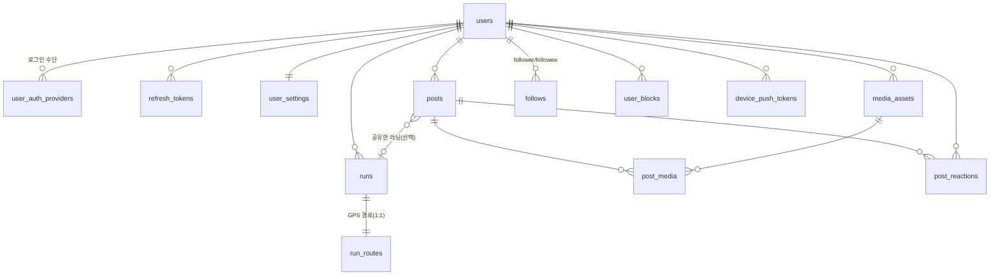

# PACE 백엔드 설계서 (Spring Boot API · DB)

PACE 앱(Expo/React Native)이 필요로 하는 백엔드 API, DB 테이블, 구현 순서를 정리한
문서입니다. Spring Boot 서버 구현과 DB 설계의 기준 문서로 사용합니다.

- 대상: Spring Boot 3.x (Java 21), Spring Security + JWT, Spring Data JPA
- DB: **PostgreSQL 16 기준**으로 작성 (MySQL 8 사용 시 차이는 [부록 B](#부록-b-mysql-8-사용-시-차이))
- 상태: 초안 v2. 경로·필드명은 구현하면서 확정합니다. 확정되면 앱의 `src/data/*` 저장소
  함수 내부만 API 호출로 교체합니다.

---

## 0. 현재 앱 데이터 현황

백엔드 연결 전이라 앱 데이터는 **기기 저장**과 **목업(UI 전용)** 두 종류입니다.

| 데이터 | 현재 위치 | 저장소 코드 | 백엔드 연결 후 |
| --- | --- | --- | --- |
| 완료한 러닝 기록 + GPS 경로 | 기기 (AsyncStorage `@pace/completed-runs`) | `src/data/completed-runs-repository.ts` | `GET/POST/DELETE /runs` |
| 진행 중인 러닝 | 기기 (`@pace/active-run`) | `src/data/active-run-store.ts` | **기기 유지** (서버 전송 X, 종료 시 `POST /runs`) |
| 주간 목표 | 기기 (`@pace/weekly-goal-km`) | `src/data/weekly-goal-repository.ts` | `GET/PATCH /users/me/settings` |
| 홈·통계 집계 | 기기 기록으로 앱에서 계산 | `src/features/running/run-insights.ts` | `GET /dashboard`, `GET /stats/running` |
| 소셜 피드 게시물·사진 | **목업** (하드코딩 샘플) | `src/features/social/*` | `/social/*`, `/media/*` |
| 프로필 이름 "PACE 러너" | **목업** | `profile-screen.tsx` | `GET /users/me` |
| 소셜 로그인 버튼 | **UI만** (실제 인증 없음) | `login-screen.tsx` | `POST /auth/{provider}` |
| 앱 설정 토글(알림·단위·비공개) | **화면 상태만** (저장 안 됨) | `settings-screen.tsx` | `PATCH /users/me/settings` |

---

## 1. 공통 규칙

| 항목 | 규칙 |
| --- | --- |
| Base path | `/api/v1` |
| 형식 | UTF-8 JSON, 필드명 camelCase |
| 인증 | `Authorization: Bearer <accessToken>` (JWT, 30분) / refresh token (30일, 회전) |
| ID | 서버 ID는 `BIGINT` 내부키 + 외부 노출용 `public_id`(ULID 문자열 26자). API에는 public_id만 노출 |
| 시간 | ISO-8601 UTC (`2026-10-21T05:00:00Z`). 앱은 epoch ms를 쓰므로 변환 필요 |
| 날짜 집계 | 요청의 `timeZone`(IANA, 기본 `Asia/Seoul`) 기준. 주 시작은 **월요일** |
| 단위 | 거리 `meters`(정수), 시간 `seconds`(정수), 페이스 `secondsPerKm`(정수, 없으면 `null`) |
| 페이지네이션 | 커서 기반: `?cursor=<opaque>&limit=20` (최대 50) → `{ items, nextCursor }` |
| 멱등성 | 생성 API(`POST /runs`, `POST /social/posts`)는 `Idempotency-Key` 헤더 지원 |
| 소프트 삭제 | 러닝·게시물은 `deleted_at` 사용 (복구·감사용), 계정 탈퇴 시 하드 삭제 배치 |

### 오류 응답

```json
{
  "code": "VALIDATION_ERROR",
  "message": "요청 값을 확인해 주세요.",
  "requestId": "01JB...",
  "fieldErrors": [{ "field": "weeklyGoalMeters", "reason": "5000~100000 사이, 5000 단위" }]
}
```

| HTTP | code | 상황 |
| --- | --- | --- |
| 400 | `VALIDATION_ERROR` | Bean Validation 실패, 형식 오류 |
| 401 | `UNAUTHORIZED` / `TOKEN_EXPIRED` | 토큰 없음·만료 (앱은 `TOKEN_EXPIRED`면 refresh 후 재시도) |
| 403 | `FORBIDDEN` | 남의 리소스 접근 |
| 404 | `NOT_FOUND` | 없는 리소스 / 삭제됨 |
| 409 | `CONFLICT` | 중복 (예: 같은 `clientRunId` 다른 내용) |
| 413 | `PAYLOAD_TOO_LARGE` | 경로 포인트·이미지 한도 초과 |
| 429 | `RATE_LIMITED` | 요청 과다 |
| 500 | `INTERNAL_ERROR` | 서버 오류 |

Spring에서는 `@RestControllerAdvice` + `ErrorCode` enum + `BusinessException` 하나로 통일합니다.

---

## 2. 도메인 / ERD



### 설계 포인트

1. **GPS 경로는 `runs`와 분리한 `run_routes` 테이블(1:1, JSONB)** 에 저장합니다.
   - 앱은 5m/1초 간격으로 수집 → 10km ≈ 2,000포인트, 1시간 ≈ 최대 3,600포인트(약 300KB).
   - 포인트를 행 단위(`run_points`)로 넣으면 러닝 1회에 수천 행 → 목록/통계 쿼리에 불필요한 부하.
   - 경로는 "러닝 상세에서 통째로 읽고 통째로 쓰는" 데이터라 1행 JSONB가 단순하고 빠릅니다.
   - 목록 화면은 `runs`만 조회 → 가볍게 유지. 지도용 축약 경로(`simplified_points`, ≤400점)도 저장.
   - 나중에 "근처 코스 검색" 같은 공간 쿼리가 필요해지면 PostGIS `geometry(LineString)` 컬럼을 추가.
2. **러닝 요약값(`distance_meters` 등)은 `runs`에 비정규화**해서 통계를 `SUM/COUNT`로 바로 계산.
3. **`(user_id, client_run_id)` 유니크** → 오프라인 재전송 시 중복 저장 방지(멱등).
4. 주간 목표는 `user_settings.weekly_goal_meters`(정수 m). 앱의 km 값 × 1000.

---

## 3. DB 테이블 (PostgreSQL DDL)

```sql
-- 공통: updated_at 은 JPA @PreUpdate 또는 트리거로 갱신

CREATE TABLE users (
  id                 BIGSERIAL PRIMARY KEY,
  public_id          CHAR(26)     NOT NULL UNIQUE,          -- ULID
  nickname           VARCHAR(30)  NOT NULL,                  -- 화면 표시명
  handle             VARCHAR(30)  UNIQUE,                    -- 검색용 별칭(@id), 선택
  profile_image_url  VARCHAR(500),
  bio                VARCHAR(150),
  profile_visibility VARCHAR(16)  NOT NULL DEFAULT 'public', -- public | followers | private
  searchable         BOOLEAN      NOT NULL DEFAULT TRUE,
  status             VARCHAR(16)  NOT NULL DEFAULT 'active', -- active | deleting | deleted
  created_at         TIMESTAMPTZ  NOT NULL DEFAULT now(),
  updated_at         TIMESTAMPTZ  NOT NULL DEFAULT now(),
  deleted_at         TIMESTAMPTZ
);
CREATE INDEX idx_users_nickname_lower ON users (lower(nickname));

-- 소셜 로그인 연결 (한 사용자에 여러 provider 연결 가능)
CREATE TABLE user_auth_providers (
  id                BIGSERIAL PRIMARY KEY,
  user_id           BIGINT       NOT NULL REFERENCES users(id) ON DELETE CASCADE,
  provider          VARCHAR(16)  NOT NULL,          -- google | kakao | apple
  provider_user_id  VARCHAR(255) NOT NULL,          -- provider의 sub / id
  email             VARCHAR(255),                   -- 받을 수 있을 때만 (Apple은 relay 메일일 수 있음)
  created_at        TIMESTAMPTZ  NOT NULL DEFAULT now(),
  last_login_at     TIMESTAMPTZ,
  UNIQUE (provider, provider_user_id)
);
CREATE INDEX idx_auth_providers_user ON user_auth_providers (user_id);

CREATE TABLE refresh_tokens (
  id           BIGSERIAL PRIMARY KEY,
  user_id      BIGINT      NOT NULL REFERENCES users(id) ON DELETE CASCADE,
  token_hash   CHAR(64)    NOT NULL UNIQUE,         -- SHA-256(원문). 원문 저장 금지
  family_id    CHAR(26)    NOT NULL,                -- 회전 체인. 재사용 감지 시 family 전체 폐기
  device_name  VARCHAR(100),
  expires_at   TIMESTAMPTZ NOT NULL,
  revoked_at   TIMESTAMPTZ,
  created_at   TIMESTAMPTZ NOT NULL DEFAULT now()
);
CREATE INDEX idx_refresh_tokens_user ON refresh_tokens (user_id);

CREATE TABLE user_settings (
  user_id                     BIGINT      PRIMARY KEY REFERENCES users(id) ON DELETE CASCADE,
  weekly_goal_meters          INT         NOT NULL DEFAULT 20000
    CHECK (weekly_goal_meters BETWEEN 5000 AND 100000 AND weekly_goal_meters % 5000 = 0),
  distance_unit               VARCHAR(4)  NOT NULL DEFAULT 'km',   -- km | mi
  time_zone                   VARCHAR(64) NOT NULL DEFAULT 'Asia/Seoul',
  notify_run_reminder         BOOLEAN     NOT NULL DEFAULT TRUE,
  notify_weekly_summary       BOOLEAN     NOT NULL DEFAULT TRUE,
  run_reminder_time           TIME,                                -- 예: 07:00 (선택)
  default_post_visibility     VARCHAR(16) NOT NULL DEFAULT 'followers',
  updated_at                  TIMESTAMPTZ NOT NULL DEFAULT now()
);

CREATE TABLE runs (
  id                          BIGSERIAL PRIMARY KEY,
  public_id                   CHAR(26)     NOT NULL UNIQUE,
  user_id                     BIGINT       NOT NULL REFERENCES users(id) ON DELETE CASCADE,
  client_run_id               VARCHAR(64)  NOT NULL,     -- 앱이 만든 id (예: local-1792561466354)
  title                       VARCHAR(60),               -- 선택. 없으면 앱이 "GPS 러닝 기록"
  started_at                  TIMESTAMPTZ  NOT NULL,
  ended_at                    TIMESTAMPTZ  NOT NULL,
  duration_seconds            INT          NOT NULL CHECK (duration_seconds >= 0),  -- 일시정지 제외
  distance_meters             INT          NOT NULL CHECK (distance_meters >= 0),
  average_pace_seconds_per_km INT,                        -- 거리 0이면 NULL
  elevation_gain_meters       INT,                        -- 선택(추후)
  route_point_count           INT          NOT NULL DEFAULT 0,
  source                      VARCHAR(16)  NOT NULL DEFAULT 'app_gps', -- app_gps | manual | import
  created_at                  TIMESTAMPTZ  NOT NULL DEFAULT now(),
  updated_at                  TIMESTAMPTZ  NOT NULL DEFAULT now(),
  deleted_at                  TIMESTAMPTZ,
  CONSTRAINT uq_runs_user_client UNIQUE (user_id, client_run_id),
  CONSTRAINT ck_runs_time CHECK (ended_at >= started_at)
);
-- 목록(최신순)·주간/월간 통계 모두 이 인덱스 하나로 처리
CREATE INDEX idx_runs_user_started ON runs (user_id, started_at DESC) WHERE deleted_at IS NULL;

CREATE TABLE run_routes (
  run_id             BIGINT      PRIMARY KEY REFERENCES runs(id) ON DELETE CASCADE,
  points             JSONB       NOT NULL,   -- 원본 [{t,lat,lng,alt,acc,spd}, ...]
  simplified_points  JSONB       NOT NULL,   -- 지도 표시용 ≤400점 [[lat,lng], ...]
  min_lat            DOUBLE PRECISION, max_lat DOUBLE PRECISION,
  min_lng            DOUBLE PRECISION, max_lng DOUBLE PRECISION,
  created_at         TIMESTAMPTZ NOT NULL DEFAULT now()
);

CREATE TABLE media_assets (
  id            BIGSERIAL PRIMARY KEY,
  public_id     CHAR(26)     NOT NULL UNIQUE,
  owner_id      BIGINT       NOT NULL REFERENCES users(id) ON DELETE CASCADE,
  purpose       VARCHAR(20)  NOT NULL,              -- social_post | profile_image
  storage_key   VARCHAR(300) NOT NULL,              -- S3/R2 object key
  content_type  VARCHAR(50)  NOT NULL,
  size_bytes    INT          NOT NULL,
  width         INT, height INT,
  status        VARCHAR(16)  NOT NULL DEFAULT 'pending', -- pending | ready | orphaned
  created_at    TIMESTAMPTZ  NOT NULL DEFAULT now()
);
CREATE INDEX idx_media_owner_status ON media_assets (owner_id, status);

CREATE TABLE posts (
  id              BIGSERIAL PRIMARY KEY,
  public_id       CHAR(26)     NOT NULL UNIQUE,
  author_id       BIGINT       NOT NULL REFERENCES users(id) ON DELETE CASCADE,
  run_id          BIGINT       REFERENCES runs(id) ON DELETE SET NULL,
  message         VARCHAR(500),
  visibility      VARCHAR(16)  NOT NULL,             -- private | followers | public
  show_route      BOOLEAN      NOT NULL DEFAULT FALSE, -- 경로 지도 공개 여부(기본 비공개)
  reaction_count  INT          NOT NULL DEFAULT 0,   -- 비정규화 카운터
  created_at      TIMESTAMPTZ  NOT NULL DEFAULT now(),
  updated_at      TIMESTAMPTZ  NOT NULL DEFAULT now(),
  deleted_at      TIMESTAMPTZ
);
CREATE INDEX idx_posts_author_created ON posts (author_id, created_at DESC) WHERE deleted_at IS NULL;
CREATE INDEX idx_posts_public_created ON posts (created_at DESC)
  WHERE deleted_at IS NULL AND visibility = 'public';

CREATE TABLE post_media (
  post_id     BIGINT   NOT NULL REFERENCES posts(id) ON DELETE CASCADE,
  media_id    BIGINT   NOT NULL REFERENCES media_assets(id),
  sort_order  SMALLINT NOT NULL,                    -- 0~3 (최대 4장)
  PRIMARY KEY (post_id, media_id)
);

CREATE TABLE post_reactions (
  post_id     BIGINT      NOT NULL REFERENCES posts(id) ON DELETE CASCADE,
  user_id     BIGINT      NOT NULL REFERENCES users(id) ON DELETE CASCADE,
  type        VARCHAR(16) NOT NULL DEFAULT 'cheer',
  created_at  TIMESTAMPTZ NOT NULL DEFAULT now(),
  PRIMARY KEY (post_id, user_id, type)
);

CREATE TABLE follows (
  follower_id  BIGINT      NOT NULL REFERENCES users(id) ON DELETE CASCADE,
  followee_id  BIGINT      NOT NULL REFERENCES users(id) ON DELETE CASCADE,
  status       VARCHAR(16) NOT NULL,                -- pending | accepted
  created_at   TIMESTAMPTZ NOT NULL DEFAULT now(),
  accepted_at  TIMESTAMPTZ,
  PRIMARY KEY (follower_id, followee_id),
  CHECK (follower_id <> followee_id)
);
CREATE INDEX idx_follows_followee ON follows (followee_id, status);

CREATE TABLE user_blocks (
  blocker_id  BIGINT      NOT NULL REFERENCES users(id) ON DELETE CASCADE,
  blocked_id  BIGINT      NOT NULL REFERENCES users(id) ON DELETE CASCADE,
  created_at  TIMESTAMPTZ NOT NULL DEFAULT now(),
  PRIMARY KEY (blocker_id, blocked_id)
);

CREATE TABLE device_push_tokens (
  id            BIGSERIAL PRIMARY KEY,
  public_id     CHAR(26)     NOT NULL UNIQUE,
  user_id       BIGINT       NOT NULL REFERENCES users(id) ON DELETE CASCADE,
  token         VARCHAR(255) NOT NULL UNIQUE,      -- Expo push token (ExponentPushToken[...])
  platform      VARCHAR(8)   NOT NULL,             -- ios | android
  active        BOOLEAN      NOT NULL DEFAULT TRUE,
  last_seen_at  TIMESTAMPTZ  NOT NULL DEFAULT now(),
  created_at    TIMESTAMPTZ  NOT NULL DEFAULT now()
);
CREATE INDEX idx_push_tokens_user ON device_push_tokens (user_id) WHERE active;
```

### `run_routes.points` JSON 형식

키를 짧게 해서 용량을 줄입니다. 앱 `RunPoint` ↔ 서버 필드 매핑:

| 앱 `RunPoint` | API (`routePoints[]`) | DB JSON 키 |
| --- | --- | --- |
| `recordedAt` (epoch ms) | `recordedAt` (ISO) | `t` (epoch ms, 정수) |
| `latitude` | `latitude` | `lat` |
| `longitude` | `longitude` | `lng` |
| `altitudeMeters` | `altitudeMeters` | `alt` |
| `accuracyMeters` | `accuracyMeters` | `acc` |
| `speedMetersPerSecond` | `speedMetersPerSecond` | `spd` |

```json
[{"t":1792561466354,"lat":37.5444,"lng":127.0374,"alt":18.2,"acc":6,"spd":2.7}, ...]
```

---

## 4. API 명세

> 표기: 🔓 인증 불필요 / 🔒 accessToken 필요. DTO는 Java `record` 기준 이름입니다.

### 4.1 인증 (Auth)

#### 🔓 `POST /auth/{provider}` — 소셜 로그인/가입

`provider`: `google` | `kakao` | `apple`. 앱이 provider SDK로 받은 토큰을 보내면, 서버가 provider에
검증 후 PACE 토큰을 발급합니다. 없는 사용자면 `users` + `user_settings` + `user_auth_providers` 생성.

```json
// SocialLoginRequest
{
  "idToken": "<google/apple id_token>",      // google, apple
  "accessToken": "<kakao access token>",     // kakao (사용자 정보 API 조회용)
  "nonce": "<apple nonce>",                  // apple
  "displayName": "김호성"                     // apple 최초 가입 시에만 전달됨(선택)
}
```

| provider | 서버 검증 방법 |
| --- | --- |
| google | id_token 서명(JWKS) + `aud` = 앱 client id 검증 |
| apple | id_token 서명(Apple JWKS) + `aud` = bundle id(`com.hocompany.pace`) + nonce 검증 |
| kakao | `GET https://kapi.kakao.com/v2/user/me` 로 access token 검증·사용자 id 조회 |

```json
// AuthTokenResponse (200)
{
  "accessToken": "eyJ...",
  "refreshToken": "rt_...",
  "accessTokenExpiresIn": 1800,
  "user": { "id": "01JB...", "nickname": "러너", "profileImageUrl": null },
  "isNewUser": true
}
```

- 신규 가입이면 `nickname` 기본값: provider 이름 → 없으면 `러너1234`.
- 로그인 전 기기에 저장된 기록은 앱이 **로그인 직후 `POST /runs`로 일괄 업로드**합니다(4.4 참고).

#### 🔓 `POST /auth/refresh`

요청 `{ "refreshToken": "rt_..." }` → 응답 `AuthTokenResponse`(user 제외 가능).
refresh token은 **매번 회전**, 이미 사용된 토큰이 다시 오면 같은 `family_id` 전체 폐기(탈취 대응).

#### 🔒 `POST /auth/logout`

요청 `{ "refreshToken": "rt_..." }` → `204`. 해당 토큰 폐기 + 요청 시 이 기기의 push token 비활성화.

---

### 4.2 내 정보 (Users)

#### 🔒 `GET /users/me`

```json
// MeResponse
{
  "id": "01JB...",
  "nickname": "PACE 러너",
  "handle": "pace_runner",
  "profileImageUrl": null,
  "bio": null,
  "profileVisibility": "public",
  "linkedProviders": ["kakao", "apple"],
  "createdAt": "2026-10-21T05:00:00Z",
  "counts": { "runs": 12, "followers": 3, "following": 5 }
}
```

#### 🔒 `PATCH /users/me`

```json
// UpdateMeRequest (모든 필드 선택)
{ "nickname": "호성", "handle": "hosung", "bio": "주 3회 러너", "profileImageId": "01JB...", "profileVisibility": "followers" }
```

검증: nickname 2~30자, handle `^[a-z0-9_.]{3,30}$` 유니크(409), bio ≤150자. 응답: `MeResponse`.

#### 🔒 `DELETE /users/me` — 회원 탈퇴

`202 { "requestId": "..." }`. `users.status = 'deleting'` → 토큰 전부 폐기 → 배치가 러닝·경로·게시물·미디어(스토리지 포함) 하드 삭제.
Apple 로그인 사용자는 Apple `revoke` API 호출 필요(App Store 심사 요구사항).

---

### 4.3 설정 (Settings) — 주간 목표 포함

#### 🔒 `GET /users/me/settings`

```json
// SettingsResponse
{
  "weeklyGoalMeters": 20000,
  "distanceUnit": "km",
  "timeZone": "Asia/Seoul",
  "notifications": { "runReminder": true, "weeklySummary": true, "runReminderTime": "07:00" },
  "defaultPostVisibility": "followers",
  "profileVisibility": "public"
}
```

#### 🔒 `PATCH /users/me/settings`

부분 갱신. 응답은 `SettingsResponse` 전체.

| 필드 | 검증 |
| --- | --- |
| `weeklyGoalMeters` | 5,000~100,000, 5,000 단위 (앱: 5~100km, 5km 단위) |
| `distanceUnit` | `km` \| `mi` |
| `timeZone` | `ZoneId.of()` 로 검증 가능한 IANA 이름 |
| `notifications.runReminderTime` | `HH:mm` |

> 앱 매핑: `weekly-goal-repository.ts` 의 `getWeeklyGoalKm()` = `weeklyGoalMeters / 1000`,
> `saveWeeklyGoalKm(km)` = `PATCH { weeklyGoalMeters: km * 1000 }`.

---

### 4.4 러닝 기록 (Runs) — 핵심

#### 🔒 `POST /runs` — 러닝 저장 (러닝 종료 시 / 오프라인 기록 동기화)

헤더 `Idempotency-Key: <clientRunId>` 권장.

```json
// CreateRunRequest
{
  "clientRunId": "local-1792561466354",
  "startedAt": "2026-10-21T05:00:00Z",
  "endedAt": "2026-10-21T05:35:12Z",
  "durationSeconds": 1949,
  "distanceMeters": 5240,
  "averagePaceSecondsPerKm": 372,
  "routePoints": [
    {
      "recordedAt": "2026-10-21T05:00:01Z",
      "latitude": 37.5444,
      "longitude": 127.0374,
      "altitudeMeters": 18.2,
      "accuracyMeters": 6,
      "speedMetersPerSecond": 2.7
    }
  ]
}
```

검증:

| 필드 | 규칙 |
| --- | --- |
| `clientRunId` | 필수, ≤64자 |
| `startedAt`/`endedAt` | 필수, `endedAt >= startedAt`, 미래 시각 불가(5분 허용 오차) |
| `durationSeconds` | 0 ≤ x ≤ `endedAt - startedAt` (일시정지 시간 제외라 더 작을 수 있음), ≤ 24h |
| `distanceMeters` | 0 ≤ x ≤ 300,000 |
| `routePoints` | 0~20,000개, lat −90~90, lng −180~180, `recordedAt` 오름차순 |

처리:

1. `(userId, clientRunId)` 가 이미 있으면 → **기존 기록을 `200`으로 반환**(멱등). 내용이 다르면 `409`.
2. 서버에서 `routePoints`로 거리 재계산(Haversine 합) → 클라이언트 값과 ±10% 이상 차이 나면 로그 남기고 서버 값 사용 여부 결정(초기엔 클라이언트 값 신뢰).
3. `averagePaceSecondsPerKm` 는 서버가 `durationSeconds / (distanceMeters/1000)` 로 재계산(거리 0이면 null).
4. `simplified_points`(≤400점) 와 bbox 계산해 `run_routes` 저장.
5. 한 트랜잭션으로 `runs` + `run_routes` 저장.

응답 `201` (`RunDetailResponse`, 아래 상세와 동일, `route` 포함).

#### 🔒 `GET /runs?cursor=&limit=20` — 기록 목록 (경로 제외)

```json
// RunListResponse
{
  "items": [
    {
      "id": "01JB...",
      "clientRunId": "local-1792561466354",
      "title": null,
      "startedAt": "2026-10-21T05:00:00Z",
      "endedAt": "2026-10-21T05:35:12Z",
      "durationSeconds": 1949,
      "distanceMeters": 5240,
      "averagePaceSecondsPerKm": 372,
      "routePointCount": 1203
    }
  ],
  "nextCursor": "eyJzIjoiMjAyNi0xMC0yMVQwNTowMDowMFoiLCJpIjoxMjN9"
}
```

정렬 `started_at DESC, id DESC`. 커서 = `(started_at, id)` base64. 쿼리:
`WHERE user_id=? AND deleted_at IS NULL AND (started_at, id) < (?, ?) ORDER BY started_at DESC, id DESC LIMIT ?`

#### 🔒 `GET /runs/{runId}?route=simplified|full|none` — 상세 (기본 `simplified`)

```json
// RunDetailResponse
{
  "id": "01JB...",
  "clientRunId": "local-1792561466354",
  "title": null,
  "startedAt": "2026-10-21T05:00:00Z",
  "endedAt": "2026-10-21T05:35:12Z",
  "durationSeconds": 1949,
  "distanceMeters": 5240,
  "averagePaceSecondsPerKm": 372,
  "averageSpeedKmh": 9.7,
  "routePointCount": 1203,
  "route": {
    "type": "simplified",
    "coordinates": [[37.5444, 127.0374], [37.5450, 127.0381]],
    "bounds": { "minLat": 37.54, "maxLat": 37.56, "minLng": 127.03, "maxLng": 127.05 }
  }
}
```

앱 지도(`route-geometry.ts` 의 `toRouteCoordinates`)는 이미 400점으로 줄여 쓰므로 `simplified`면 충분합니다.
`full` 은 GPX 내보내기 등에서만 사용. 본인 기록이 아니면 `404`(존재 여부 노출 방지).

#### 🔒 `PATCH /runs/{runId}` — 제목 수정 (선택 기능)

`{ "title": "한강 저녁 러닝" }` (≤60자) → `RunDetailResponse`.

#### 🔒 `DELETE /runs/{runId}` — 기록 삭제

`204`. 소프트 삭제(`deleted_at = now()`). 앱의 **밀어서 삭제 → 되돌리기(4초)** 는 앱이 4초 지연 후
DELETE를 보내거나, 아래 복구 API로 처리합니다.

#### 🔒 `POST /runs/{runId}/restore` — 삭제 되돌리기

`200 RunDetailResponse`. 삭제 후 일정 기간(예: 24시간) 내에만 허용.

#### 오프라인/로그인 전 기록 동기화 흐름

```text
앱: 러닝 종료 → 기기 저장(지금과 동일) → POST /runs 시도
 ├─ 성공: 기기 기록에 serverId 표시(synced)
 └─ 실패(오프라인/비로그인): pending 으로 남김 → 앱 시작·로그인·네트워크 복구 시 재전송
서버: clientRunId 유니크 → 몇 번을 다시 보내도 1건만 저장
```

---

### 4.5 홈 대시보드

#### 🔒 `GET /dashboard?timeZone=Asia/Seoul`

홈 화면 한 번에 그리기용(오늘 거리 + 이번 주 + 최근 러닝).

```json
// DashboardResponse
{
  "today": { "date": "2026-10-21", "distanceMeters": 5240 },
  "week": {
    "from": "2026-10-19",
    "to": "2026-10-25",
    "goalMeters": 20000,
    "distanceMeters": 8340,
    "runCount": 2,
    "dailyDistances": [2800, 0, 5240, 0, 0, 0, 0]
  },
  "recentRun": {
    "id": "01JB...",
    "startedAt": "2026-10-21T05:00:00Z",
    "distanceMeters": 5240,
    "durationSeconds": 1949,
    "averagePaceSecondsPerKm": 372
  }
}
```

- `dailyDistances` 는 **월~일 7칸 고정**(기록 없는 날 0). 앱 `getWeeklyInsights()` 와 동일한 규칙.
- 러닝 시작 화면의 "이번 주 목표 / 최근 러닝" 카드도 이 API를 사용.

집계 SQL 예시(PostgreSQL):

```sql
SELECT (started_at AT TIME ZONE :tz)::date AS day,
       SUM(distance_meters) AS meters, COUNT(*) AS runs
FROM runs
WHERE user_id = :uid AND deleted_at IS NULL
  AND started_at >= :weekStartUtc AND started_at < :weekEndUtc
GROUP BY day;
```

---

### 4.6 통계

#### 🔒 `GET /stats/running?period=week|month&date=2026-10-21&timeZone=Asia/Seoul`

`date` 가 속한 주/월을 집계(기본 오늘). 앱의 주간/월간 탭 + 전체 요약.

```json
// RunningStatsResponse
{
  "period": "week",
  "from": "2026-10-19",
  "to": "2026-10-25",
  "totals": {
    "distanceMeters": 8340,
    "durationSeconds": 3149,
    "runCount": 2,
    "averagePaceSecondsPerKm": 378,
    "longestRunMeters": 5240
  },
  "buckets": [
    { "label": "월", "from": "2026-10-19", "distanceMeters": 2800, "runCount": 1 }
  ],
  "allTime": {
    "distanceMeters": 8340,
    "runCount": 2,
    "averagePaceSecondsPerKm": 378
  }
}
```

- `week`: 버킷 7개(월~일). `month`: 해당 월의 **주 단위** 버킷(앱의 `1주, 2주…`).
- 평균 페이스 = `SUM(duration) / (SUM(distance)/1000)` (거리 가중 평균, 앱과 동일).

---

### 4.7 소셜 — 피드·게시물

#### 🔒 `GET /social/feed?filter=following|public&cursor=&limit=20`

- `following`: 나 + 내가 팔로우(`accepted`)한 사용자의 `public`/`followers` 게시물
- `public`: 전체 공개 게시물 (추천 탭)
- 차단 관계(양방향) 제외, `deleted_at IS NULL`

```json
// FeedResponse
{
  "items": [
    {
      "id": "01JB...",
      "author": { "id": "01JA...", "nickname": "지수", "profileImageUrl": null },
      "createdAt": "2026-10-21T06:30:00Z",
      "message": "오늘 아침 한강 러닝 완료!",
      "visibility": "followers",
      "media": [{ "id": "01JC...", "url": "https://cdn.../a.jpg", "width": 1200, "height": 1600 }],
      "run": {
        "id": "01JB...",
        "distanceMeters": 5200,
        "durationSeconds": 1910,
        "averagePaceSecondsPerKm": 368,
        "route": null
      },
      "reactionCount": 12,
      "reactedByMe": false,
      "isMine": false
    }
  ],
  "nextCursor": null
}
```

`run.route` 는 게시물의 `show_route = true` 일 때만 simplified 좌표를 포함(위치 노출 방지).

#### 🔒 `POST /social/posts`

```json
// CreatePostRequest
{
  "message": "한강 저녁 러닝 완료!",
  "visibility": "followers",
  "mediaIds": ["01JC...", "01JC..."],
  "runId": "01JB...",
  "showRoute": false
}
```

검증: `visibility` 필수, message ≤500자, mediaIds ≤4(본인 소유·`ready` 상태), runId 본인 소유,
message/media/run 중 최소 하나. 응답 `201` = 피드 항목 1개.

#### 🔒 `GET /social/posts/me?cursor=&limit=20` — 내 게시물
#### 🔒 `GET /social/users/{userId}/posts?cursor=&limit=20` — 특정 사용자 게시물 (공개 범위·팔로우 확인)
#### 🔒 `DELETE /social/posts/{postId}` — `204`, 작성자만

#### 🔒 `PUT /social/posts/{postId}/reactions/cheer` / `DELETE` 동일 경로

응원 추가/취소(멱등). 응답 `{ "reactionCount": 13, "reactedByMe": true }`.
`post_reactions` insert/delete 와 `posts.reaction_count` 증감을 한 트랜잭션에서 처리.

---

### 4.8 미디어 업로드 (게시물 사진·프로필 이미지)

앱 → 서버에 presigned URL 요청 → 앱이 스토리지(S3/Cloudflare R2)로 직접 PUT → 완료 통보.

#### 🔒 `POST /media/uploads`

```json
// 요청
{ "purpose": "social_post", "contentType": "image/jpeg", "sizeBytes": 1824000 }
// 응답 201
{ "mediaId": "01JC...", "uploadUrl": "https://...signed", "method": "PUT",
  "headers": { "Content-Type": "image/jpeg" }, "expiresAt": "2026-10-21T07:00:00Z" }
```

허용: `image/jpeg`, `image/png`, `image/heic`, `image/webp`, 최대 10MB. URL 유효 5분.

#### 🔒 `POST /media/{mediaId}/complete`

서버가 객체 존재·크기·MIME 확인 → **EXIF(GPS) 제거·리사이즈** → `status = ready`.
응답 `{ "id", "url", "width", "height" }`. 24시간 내 게시물에 연결 안 된 `pending/ready` 미디어는 배치로 정리.

---

### 4.9 친구(팔로우)·검색·차단

| Method | Path | 설명 |
| --- | --- | --- |
| 🔒 GET | `/social/users?query=호성&cursor=&limit=20` | 닉네임/handle 부분 일치(2자 이상, `searchable=true`, 차단 제외) |
| 🔒 GET | `/social/users/{userId}` | 프로필 카드 (공개 범위에 따라 러닝 통계 노출) |
| 🔒 POST | `/social/follows/{userId}` | 팔로우. 상대가 `private` 면 `pending`, 아니면 `accepted` |
| 🔒 DELETE | `/social/follows/{userId}` | 언팔로우 / 보낸 요청 취소 |
| 🔒 GET | `/social/follows?type=following\|followers&cursor=` | 목록 |
| 🔒 GET | `/social/follow-requests?cursor=` | 받은 요청(pending) |
| 🔒 POST | `/social/follow-requests/{userId}/accept` | 수락 |
| 🔒 DELETE | `/social/follow-requests/{userId}` | 거절 |
| 🔒 POST / DELETE | `/social/blocks/{userId}` | 차단 / 해제 (차단 시 양방향 follow 삭제) |

사용자 항목 DTO: `{ "id", "nickname", "handle", "profileImageUrl", "followStatus": "none|requested|following|follows_you|mutual" }`

---

### 4.10 푸시 알림 기기 등록

| Method | Path | 설명 |
| --- | --- | --- |
| 🔒 POST | `/devices/push-tokens` | `{ "token": "ExponentPushToken[...]", "platform": "ios" }` → upsert, `{ "id", "active": true }` |
| 🔒 DELETE | `/devices/push-tokens/{id}` | 비활성화 (로그아웃 시) |

발송은 Expo Push API(`https://exp.host/--/api/v2/push/send`) 사용 → APNs/FCM 직접 연동 불필요.
`DeviceNotRegistered` 응답을 받으면 해당 토큰 `active=false`.

---

## 5. Spring Boot 구현 가이드

### 5.1 의존성

`spring-boot-starter-web`, `-validation`, `-data-jpa`, `-security`, `-oauth2-resource-server`(JWT 검증),
`postgresql`, `flyway-core`(+ `flyway-database-postgresql`), `hypersistence-utils-hibernate-63`(JSONB 매핑),
`com.github.f4b6a3:ulid-creator`, `software.amazon.awssdk:s3`(presigned URL), `springdoc-openapi-starter-webmvc-ui`(Swagger).

### 5.2 패키지 구조 (도메인별)

```text
com.pace
 ├─ common      (ErrorCode, BusinessException, GlobalExceptionHandler, CursorPage, BaseTimeEntity)
 ├─ config      (SecurityConfig, JwtConfig, S3Config, JacksonConfig)
 ├─ auth        (AuthController, AuthService, provider/{Google,Apple,Kakao}Verifier, RefreshToken*)
 ├─ user        (User, UserSettings, UserController, SettingsController)
 ├─ run         (Run, RunRoute, RunController, RunService, RouteSimplifier, DistanceCalculator)
 ├─ stats       (DashboardController, StatsController, StatsQueryRepository)
 ├─ social      (Post, PostMedia, PostReaction, Follow, Block, FeedService ...)
 ├─ media       (MediaAsset, MediaController, StorageService, ImageProcessor)
 └─ device      (DevicePushToken, PushService)
```

### 5.3 예시 코드 (Run 생성)

```java
public record RoutePointDto(
    @NotNull Instant recordedAt,
    @DecimalMin("-90") @DecimalMax("90") double latitude,
    @DecimalMin("-180") @DecimalMax("180") double longitude,
    Double altitudeMeters, Double accuracyMeters, Double speedMetersPerSecond) {}

public record CreateRunRequest(
    @NotBlank @Size(max = 64) String clientRunId,
    @NotNull Instant startedAt,
    @NotNull Instant endedAt,
    @PositiveOrZero @Max(86_400) int durationSeconds,
    @PositiveOrZero @Max(300_000) int distanceMeters,
    Integer averagePaceSecondsPerKm,
    @NotNull @Size(max = 20_000) List<@Valid RoutePointDto> routePoints) {}

@PostMapping("/runs")
public ResponseEntity<RunDetailResponse> create(@AuthenticationPrincipal AuthUser me,
                                                @Valid @RequestBody CreateRunRequest req) {
  CreateResult r = runService.create(me.id(), req);   // 이미 있으면 created=false
  return ResponseEntity.status(r.created() ? 201 : 200).body(r.body());
}
```

`RunRoute.points` 는 `@Type(JsonType.class) @Column(columnDefinition = "jsonb") List<StoredPoint>` 로 매핑합니다.
DB 마이그레이션은 Flyway `V1__init.sql` 에 3장의 DDL을 그대로 사용합니다.

### 5.4 환경별 설정

| 환경 | 앱 (EAS) | 서버 |
| --- | --- | --- |
| development | `EXPO_PUBLIC_API_BASE_URL=http://<내PC IP>:8080/api/v1` | `application-local.yml`, Docker PostgreSQL |
| preview (TestFlight) | `eas env` preview: `https://api-dev.<도메인>/api/v1` | dev 서버/DB |
| production | `eas env` production: `https://api.<도메인>/api/v1` | prod 서버/DB |

앱은 `process.env.EXPO_PUBLIC_API_BASE_URL` 로 읽습니다. 비밀값(JWT 키, provider secret, S3 키)은
**서버에만** 두고 앱에는 넣지 않습니다.

---

## 6. 구현 우선순위

| 단계 | 범위 | 앱에서 바뀌는 것 |
| --- | --- | --- |
| **1. MVP** | Auth(Apple·Kakao·Google) + `GET/PATCH /users/me` + settings + `POST/GET/DELETE /runs` + `/runs/{id}` | 로그인 실제 동작, 기록·목표 서버 저장, 기기 기록 업로드 |
| 2. 집계 | `/dashboard`, `/stats/running` | 홈·통계를 서버 집계로 (기기 계산은 오프라인 fallback) |
| 3. 소셜 | media 업로드, posts, feed, reactions | 소셜 탭 목업 제거 |
| 4. 친구 | follows, 검색, 요청, 차단 | 친구 찾기·관리 |
| 5. 알림 | push token, 리마인더/주간 리포트 배치 | 설정 토글 실제 동작 |
| 6. 탈퇴 | `DELETE /users/me` + 삭제 배치 | **App Store 제출 전 필수**(계정 생성이 있는 앱은 앱 내 탈퇴 필수) |

---

## 7. 화면별 API 연결 표

| 앱 화면 (파일) | API |
| --- | --- |
| 로그인 (`features/auth/login-screen.tsx`) | `POST /auth/{provider}` |
| 홈 (`features/home/home-screen.tsx`) | `GET /dashboard` (+ `GET /users/me` 인사말) |
| 러닝 시작 (`features/running/run-ready-view.tsx`) | `GET /dashboard` |
| 러닝 중 (`features/running/run-tracking-screen.tsx`) | 없음 (기기). 종료 시 `POST /runs` |
| 기록 목록 (`features/runs/runs-screen.tsx`) | `GET /runs`, `DELETE /runs/{id}`, `POST /runs/{id}/restore` |
| 기록 상세 (`features/runs/run-detail-screen.tsx`) | `GET /runs/{id}?route=simplified` |
| 통계 (`features/stats/stats-screen.tsx`) | `GET /stats/running` |
| 소셜 (`features/social/*`) | `/social/feed`, `/social/posts`, `/media/*`, reactions |
| 마이 (`features/profile/profile-screen.tsx`) | `GET /users/me`, `GET /users/me/settings` |
| 주간 목표 (`features/profile/weekly-goal-screen.tsx`) | `PATCH /users/me/settings` |
| 설정 (`features/settings/settings-screen.tsx`) | `GET/PATCH /users/me/settings`, push token, `DELETE /users/me`, `POST /auth/logout` |

---

## 8. 결정이 필요한 사항

1. 거리 계산 최종 책임: 초기엔 클라이언트 값 저장 + 서버 재계산 값 로그 비교 → 이후 서버 값으로 통일할지
2. 원본 GPS(`run_routes.points`) 보관 기간 (예: 무기한 vs 1년 후 simplified만 남기기)
3. 삭제 되돌리기 허용 기간(24시간 제안)과 소프트 삭제 데이터 영구 삭제 주기
4. 로그인 전 기기 기록을 로그인 시 자동 업로드할지, 사용자에게 물어볼지
5. 피드 기본 공개 범위(`followers` 제안), 경로 지도 공개 기본값(비공개 제안)
6. 이미지 스토리지(S3 vs Cloudflare R2 — R2는 전송료 무료)와 CDN 도메인
7. access/refresh 토큰 만료(30분/30일 제안)
8. 신고 기능·운영자 관리 범위

---

## 부록 A. 앱 타입 ↔ API 변환

| 앱 (`src/features/running/types.ts`) | API |
| --- | --- |
| `CompletedRun.id` (`local-<ms>`) | `clientRunId` (서버 `id`는 별도) |
| `startedAt`, `endedAt` (epoch ms) | ISO-8601 문자열 (`new Date(ms).toISOString()`) |
| `distanceMeters` (number) | 정수 (`Math.round`) |
| `durationSeconds` | 정수 |
| `averagePaceSecondsPerKm` (`number \| null`) | 동일 |
| `routePoints[].recordedAt` (ms) | ISO-8601 |
| 주간 목표 km (`getWeeklyGoalKm`) | `weeklyGoalMeters` (× 1000) |

## 부록 B. MySQL 8 사용 시 차이

- `BIGSERIAL` → `BIGINT AUTO_INCREMENT`, `TIMESTAMPTZ` → `DATETIME(3)` (UTC 저장 규칙 필수), `JSONB` → `JSON`
- 부분 인덱스(`WHERE deleted_at IS NULL`) 미지원 → 일반 복합 인덱스 `(user_id, deleted_at, started_at)`
- `CHECK` 는 8.0.16+ 에서 동작, `AT TIME ZONE` 대신 `CONVERT_TZ(started_at, '+00:00', 'Asia/Seoul')` (타임존 테이블 로드 필요)
- `lower(nickname)` 함수 인덱스는 8.0.13+ (`((lower(nickname)))`), 또는 `utf8mb4_0900_ai_ci` collation으로 대소문자 무시
