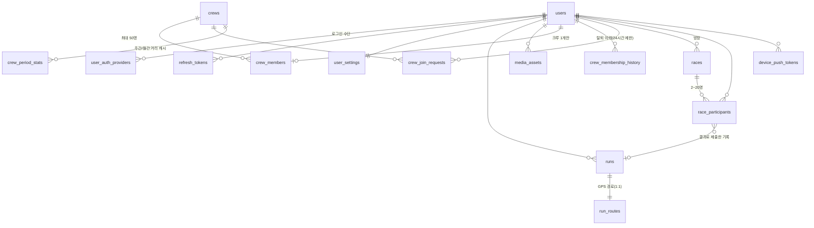

# PACE 백엔드 설계서 (Spring Boot API · DB)

PACE 앱(Expo/React Native)이 필요로 하는 백엔드 API, DB 테이블, 구현 순서를 정리한
문서입니다. Spring Boot 서버 구현과 DB 설계의 기준 문서로 사용합니다.

- 대상: Spring Boot 3.x (Java 21), Spring Security + JWT, Spring Data JPA
- DB: **PostgreSQL 16 기준**으로 작성 (MySQL 8 사용 시 차이는 [부록 B](#부록-b-mysql-8-사용-시-차이))
- 상태: 초안 v3.1 (소셜 피드 → 크루·대결, 크루 활동 지역·크루/대결 찾기 추가). 경로·필드명은 구현하면서 확정합니다. 확정되면 앱의 `src/data/*` 저장소
  함수 내부만 API 호출로 교체합니다.

---

## 0. 현재 앱 데이터 현황

아래 표와 후속 설계는 초기 API 요구사항입니다. 현재 iOS Google 인증, 계정 프로필·설정,
러닝 기록·경로·삭제·복구, 홈과 통계를 실제 Spring Boot API에 연결했습니다.
기기 모드는 유지하며 크루·대결 목업 저장소는 인증된 API 호출로 교체했습니다.
실제 배포 계약은 서버 OpenAPI가 우선이며,
접속 주소·제약·빌드 절차는 [README](../README.md#백엔드-연동과-ios-빌드)를 확인하세요.
아래 표의 “현재 위치”는 연동 전 기준입니다.

### 현재 크루·대결 연동 범위

아래의 상세 설계에는 미구현 기능도 포함되어 있습니다. 현재 프론트 연동 계약은 다음과 같습니다.
목록은 페이지 객체가 아닌 배열이며, API 시간은 ISO 문자열, 화면 내부 시간은 epoch ms입니다.

- 크루: `GET /crews/rankings?period=week|month`, `GET /crews?query=&sido=&sigungu=`,
  `GET /users/me/crew` (`{crewId: string | null}`), `GET /crews/{id}?period=`.
- 생성·가입: `POST /crews` (`{id}` 응답), `POST /crews/join-by-code` (`{code}` → `{id}`),
  `POST /crews/{id}/join-requests`, `DELETE /crews/join-requests/me`,
  `DELETE /crews/{id}/members/me`.
- 크루장: `POST /crews/{id}/invite-code`, `GET /crews/{id}/join-requests`,
  `POST /crews/{id}/join-requests/{userId}/approve|reject`,
  `POST /crews/{id}/leader` (`{userId}`).
- 크루 수정: `PATCH /crews/{id}`에 생성과 같은 전체 편집 필드(`name`, `intro`, `region`)를 전송하고
  `204`를 받습니다. 크루장만 가능하며 시/도 전체(`sigungu: null`)도 지원합니다.
- 대결: `GET /races?scope=open|mine&distanceMeters=&from=&to=&hideFull=`,
  `GET /races/{id}`, `POST /races` (`{id}`).
- 참가·취소: `POST /races/{id}/participants`, `DELETE /races/{id}/participants/me`,
  `POST /races/join-by-code` (`{code}` → `{id}`), `POST /races/{id}/cancel`.
- 대결 생성 필드: `title`, `distanceMeters`, `startsAt`, `joinDeadlineMinutes`,
  `minParticipants`, `maxParticipants`, `visibility`. 참가자 결과는 현재 `null`입니다.
  자동 러닝 시작, GPS 결과 제출·검증, 결과 랭킹은 아직 지원하지 않습니다.
- 대결 수정: `PATCH /races/{id}`에 생성과 같은 전체 편집 필드를 전송하고 `204`를 받습니다.
  모집 마감 전·미취소 상태에서 방장만 가능합니다. 다른 참가자가 있으면 이름·최대 인원만 바꿀 수 있으며,
  최대 인원은 현재 참가 인원보다 줄일 수 없습니다. 서버가 행 잠금 안에서 권한·모집 상태·인원을 재검사합니다.
  프론트는 기존 시각을 임의로 반올림하지 않고 보존하며 상세 화면으로 돌아오면 다시 조회합니다.
  **수정 API는 백엔드 배포 후 사용 가능합니다.** 기존 DB는 시/도 전체 지원을 위해
  백엔드의 `database/crew-region-schema.sql`을 먼저 수동 적용해야 합니다.
  이 작업에서는 서버 배포나 실제 DB 변경을 실행하지 않습니다.
- 현재 서버 필드는 `isMine`, `isMe`, `isHost`, `isJoined`를 그대로 사용합니다.
  가입 신청 목록은 `{userId, nickname}[]`입니다.
- 게스트에게는 로그인 안내, 빈 목록에는 생성 안내, 요청 실패에는 오류와 재시도를 표시합니다.
  미구현 기능에 샘플·가짜 성공 응답을 사용하지 않습니다.
- 수동 DB 스키마 적용과 백엔드 배포가 OTA보다 먼저입니다.
  배포 순서는 [README](../README.md#크루대결-api-배포-순서)를 따릅니다.

### 러닝 성취·회고·공동 목표 계약

모든 경로는 기존 API base 뒤에 붙이며 인증된 계정에 귀속됩니다.

- `GET /users/me/progress`: `totalDistanceKm`, `totalRuns`, `weeklyDistanceKm`, `weeklyRuns`,
  `weeklyGoalKm`, `representativeBadgeId`, `badges[]`, `personalBests[]`.
  배지는 `{id,title,description,target,progress,earnedAt}`이고 미획득 시 `earnedAt:null`입니다.
  최고 기록은 `{id,title,value,unit,achievedAt,runId}`입니다. `longest-run`(km)과
  `fastest-1km`(seconds)를 제공하며 `achievedAt`은 해당 러닝의 종료 시각입니다.
  1km는 연속 GPS 시각·누적 거리에서 양 끝 경계를 보간해 최단 실제 경과 시간을 구합니다.
  30초 초과 공백·정확도 35m 초과·구간 속도 8m/s 초과 등은 구간을 끊고, 짧은 정지는 포함합니다.
  밀리초 단위 비교에서 동률이면 먼저 완료한 기록을 유지합니다. 평균 페이스를 환산하지 않습니다.
- `PUT /users/me/progress/representative-badge`의 `{badgeId:string|null}`로 획득한 대표 배지를 선택/해제합니다.
  주간 목표는 새 저장소를 만들지 않고 기존 `PATCH /users/me/settings`의 `weeklyGoalMeters`를 재사용합니다.
- `GET /runs/{runId}/reflection`: `{effort:null|'easy'|'moderate'|'hard',note:string}`.
  `PUT`은 선택한 effort와 500자 이내 note를 보내며 본인의 동기화된 기록만 편집할 수 있습니다.
- `GET /crews/{crewId}/goal`: `{month,targetKm,totalKm,canEdit,contributors:[{userId,nickname,distanceKm}]}`.
  현재 크루 멤버만 조회하고 크루장만 `PUT`에 `{targetKm:1..10000}` 정수를 보냅니다.
  한국 달력의 해당 월, 현재 멤버의 가입 후 시작한 러닝만 합산합니다.
- 클라이언트는 API 실패를 빈 배지·저장 성공으로 대체하지 않습니다. 운영 DB에 백엔드의
  `database/progress-schema.sql` 수동 적용 및 API 배포가 선행되어야 합니다.
- 음성·이미지 공유용 네이티브 모듈 추가로 앱 런타임은 1.0.5이며 1.0.4용 OTA와 호환되지 않습니다.

| 데이터 | 현재 위치 | 저장소 코드 | 백엔드 연결 후 |
| --- | --- | --- | --- |
| 완료한 러닝 기록 + GPS 경로 | 기기 (AsyncStorage `@pace/completed-runs`) | `src/data/completed-runs-repository.ts` | `GET/POST/DELETE /runs` |
| 진행 중인 러닝 | 기기 (`@pace/active-run`) | `src/data/active-run-store.ts` | **기기 유지** (서버 전송 X, 종료 시 `POST /runs`) |
| 주간 목표 | 기기 (`@pace/weekly-goal-km`) | `src/data/weekly-goal-repository.ts` | `GET/PATCH /users/me/settings` |
| 홈·통계 집계 | 기기 기록으로 앱에서 계산 | `src/features/running/run-insights.ts` | `GET /dashboard`, `GET /stats/running` |
| 크루 랭킹·크루 상세·멤버 | **목업** (메모리, 앱 재시작 시 초기화) | `src/data/crew-repository.ts` | `/crews/*`, `GET /users/me/crew` |
| 대결 목록·상세·참가·결과 | **목업** (메모리, 앱 재시작 시 초기화) | `src/data/race-repository.ts` | `/races/*` |
| 프로필 이름 "PACE 러너" | **목업** | `profile-screen.tsx` | `GET /users/me` |
| 소셜 로그인 버튼 | **UI만** (실제 인증 없음) | `login-screen.tsx` | `POST /auth/{provider}` |
| 앱 설정 토글(알림·단위·비공개) | **화면 상태만** (저장 안 됨) | `settings-screen.tsx` | `PATCH /users/me/settings` |

---

## 1. 공통 규칙

| 항목 | 규칙 |
| --- | --- |
| Base path | `/api/v1` |
| 형식 | UTF-8 JSON, 필드명 camelCase |
| 인증 | `Authorization: Bearer <accessToken>` (JWT, 30분) / refresh token (30일, 회전) |
| ID | 서버 ID는 `BIGINT` 내부키 + 외부 노출용 `public_id`(ULID 문자열 26자). API에는 public_id만 노출 |
| 시간 | ISO-8601 UTC (`2026-10-21T05:00:00Z`). 앱은 epoch ms를 쓰므로 변환 필요 |
| 날짜 집계 | 요청의 `timeZone`(IANA, 기본 `Asia/Seoul`) 기준. 주 시작은 **월요일** |
| 단위 | 거리 `meters`(정수), 시간 `seconds`(정수), 페이스 `secondsPerKm`(정수, 없으면 `null`) |
| 페이지네이션 | 커서 기반: `?cursor=<opaque>&limit=20` (최대 50) → `{ items, nextCursor }` |
| 멱등성 | `POST /runs`, `POST /races/{id}/result` 는 `Idempotency-Key` 헤더 지원 (재전송 안전) |
| 소프트 삭제 | 러닝은 `deleted_at` 사용 (복구·감사용), 계정 탈퇴 시 하드 삭제 배치 |

### 오류 응답

```json
{
  "code": "VALIDATION_ERROR",
  "message": "요청 값을 확인해 주세요.",
  "requestId": "01JB...",
  "fieldErrors": [{ "field": "weeklyGoalMeters", "reason": "5000~100000 사이, 5000 단위" }]
}
```

| HTTP | code | 상황 |
| --- | --- | --- |
| 400 | `VALIDATION_ERROR` | Bean Validation 실패, 형식 오류 |
| 401 | `UNAUTHORIZED` / `TOKEN_EXPIRED` | 토큰 없음·만료 (앱은 `TOKEN_EXPIRED`면 refresh 후 재시도) |
| 403 | `FORBIDDEN` | 남의 리소스 접근 |
| 404 | `NOT_FOUND` | 없는 리소스 / 삭제됨 |
| 409 | `CONFLICT` | 중복 (예: 같은 `clientRunId` 다른 내용) |
| 413 | `PAYLOAD_TOO_LARGE` | 경로 포인트·이미지 한도 초과 |
| 429 | `RATE_LIMITED` | 요청 과다 |
| 500 | `INTERNAL_ERROR` | 서버 오류 |

Spring에서는 `@RestControllerAdvice` + `ErrorCode` enum + `BusinessException` 하나로 통일합니다.

---

## 2. 도메인 / ERD



### 설계 포인트

1. **GPS 경로는 `runs`와 분리한 `run_routes` 테이블(1:1, JSONB)** 에 저장합니다.
   - 앱은 5m/1초 간격으로 수집 → 10km ≈ 2,000포인트, 1시간 ≈ 최대 3,600포인트(약 300KB).
   - 포인트를 행 단위(`run_points`)로 넣으면 러닝 1회에 수천 행 → 목록/통계 쿼리에 불필요한 부하.
   - 경로는 "러닝 상세에서 통째로 읽고 통째로 쓰는" 데이터라 1행 JSONB가 단순하고 빠릅니다.
   - 목록 화면은 `runs`만 조회 → 가볍게 유지. 지도용 축약 경로(`simplified_points`, ≤400점)도 저장.
   - 나중에 "근처 코스 검색" 같은 공간 쿼리가 필요해지면 PostGIS `geometry(LineString)` 컬럼을 추가.
2. **러닝 요약값(`distance_meters` 등)은 `runs`에 비정규화**해서 통계를 `SUM/COUNT`로 바로 계산.
3. **`(user_id, client_run_id)` 유니크** → 오프라인 재전송 시 중복 저장 방지(멱등).
4. 주간 목표는 `user_settings.weekly_goal_meters`(정수 m). 앱의 km 값 × 1000.
5. **크루 1개 제한은 `crew_members.user_id` PK로 DB가 보장**. 랭킹은 `crew_period_stats` 캐시 테이블(주/월 × 크루)로 읽기만 하게.
6. **대결 상태는 시각(`join_deadline_at`, `starts_at`, `ends_at`)으로 결정**되고 스케줄러가 `status` 컬럼을 맞춰 줌.
   결과는 별도 테이블 없이 `race_participants` 에 `run_id`·`finish_seconds`·`rank` 로 저장.

---

## 3. DB 테이블 (PostgreSQL DDL)

```sql
-- 공통: updated_at 은 JPA @PreUpdate 또는 트리거로 갱신

CREATE TABLE users (
  id                 BIGSERIAL PRIMARY KEY,
  public_id          CHAR(26)     NOT NULL UNIQUE,          -- ULID
  nickname           VARCHAR(30)  NOT NULL,                  -- 화면 표시명
  handle             VARCHAR(30)  UNIQUE,                    -- 검색용 별칭(@id), 선택
  profile_image_url  VARCHAR(500),
  bio                VARCHAR(150),
  profile_visibility VARCHAR(16)  NOT NULL DEFAULT 'public', -- public | private (크루·대결에서 기록 노출 범위)
  searchable         BOOLEAN      NOT NULL DEFAULT TRUE,
  status             VARCHAR(16)  NOT NULL DEFAULT 'active', -- active | deleting | deleted
  created_at         TIMESTAMPTZ  NOT NULL DEFAULT now(),
  updated_at         TIMESTAMPTZ  NOT NULL DEFAULT now(),
  deleted_at         TIMESTAMPTZ
);
CREATE INDEX idx_users_nickname_lower ON users (lower(nickname));

-- 소셜 로그인 연결 (한 사용자에 여러 provider 연결 가능)
CREATE TABLE user_auth_providers (
  id                BIGSERIAL PRIMARY KEY,
  user_id           BIGINT       NOT NULL REFERENCES users(id) ON DELETE CASCADE,
  provider          VARCHAR(16)  NOT NULL,          -- google | kakao | apple
  provider_user_id  VARCHAR(255) NOT NULL,          -- provider의 sub / id
  email             VARCHAR(255),                   -- 받을 수 있을 때만 (Apple은 relay 메일일 수 있음)
  created_at        TIMESTAMPTZ  NOT NULL DEFAULT now(),
  last_login_at     TIMESTAMPTZ,
  UNIQUE (provider, provider_user_id)
);
CREATE INDEX idx_auth_providers_user ON user_auth_providers (user_id);

CREATE TABLE refresh_tokens (
  id           BIGSERIAL PRIMARY KEY,
  user_id      BIGINT      NOT NULL REFERENCES users(id) ON DELETE CASCADE,
  token_hash   CHAR(64)    NOT NULL UNIQUE,         -- SHA-256(원문). 원문 저장 금지
  family_id    CHAR(26)    NOT NULL,                -- 회전 체인. 재사용 감지 시 family 전체 폐기
  device_name  VARCHAR(100),
  expires_at   TIMESTAMPTZ NOT NULL,
  revoked_at   TIMESTAMPTZ,
  created_at   TIMESTAMPTZ NOT NULL DEFAULT now()
);
CREATE INDEX idx_refresh_tokens_user ON refresh_tokens (user_id);

CREATE TABLE user_settings (
  user_id                     BIGINT      PRIMARY KEY REFERENCES users(id) ON DELETE CASCADE,
  weekly_goal_meters          INT         NOT NULL DEFAULT 20000
    CHECK (weekly_goal_meters BETWEEN 5000 AND 100000 AND weekly_goal_meters % 5000 = 0),
  distance_unit               VARCHAR(4)  NOT NULL DEFAULT 'km',   -- km | mi
  time_zone                   VARCHAR(64) NOT NULL DEFAULT 'Asia/Seoul',
  notify_run_reminder         BOOLEAN     NOT NULL DEFAULT TRUE,
  notify_weekly_summary       BOOLEAN     NOT NULL DEFAULT TRUE,
  run_reminder_time           TIME,                                -- 예: 07:00 (선택)
  notify_race                 BOOLEAN     NOT NULL DEFAULT TRUE,   -- 대결 확정/취소/출발/결과 푸시
  notify_crew                 BOOLEAN     NOT NULL DEFAULT TRUE,   -- 가입 신청·승인 푸시
  updated_at                  TIMESTAMPTZ NOT NULL DEFAULT now()
);

CREATE TABLE runs (
  id                          BIGSERIAL PRIMARY KEY,
  public_id                   CHAR(26)     NOT NULL UNIQUE,
  user_id                     BIGINT       NOT NULL REFERENCES users(id) ON DELETE CASCADE,
  client_run_id               VARCHAR(64)  NOT NULL,     -- 앱이 만든 id (예: local-1792561466354)
  title                       VARCHAR(60),               -- 선택. 없으면 앱이 "GPS 러닝 기록"
  started_at                  TIMESTAMPTZ  NOT NULL,
  ended_at                    TIMESTAMPTZ  NOT NULL,
  duration_seconds            INT          NOT NULL CHECK (duration_seconds >= 0),  -- 일시정지 제외
  distance_meters             INT          NOT NULL CHECK (distance_meters >= 0),
  average_pace_seconds_per_km INT,                        -- 거리 0이면 NULL
  elevation_gain_meters       INT,                        -- 선택(추후)
  route_point_count           INT          NOT NULL DEFAULT 0,
  source                      VARCHAR(16)  NOT NULL DEFAULT 'app_gps', -- app_gps | manual | import
  created_at                  TIMESTAMPTZ  NOT NULL DEFAULT now(),
  updated_at                  TIMESTAMPTZ  NOT NULL DEFAULT now(),
  deleted_at                  TIMESTAMPTZ,
  CONSTRAINT uq_runs_user_client UNIQUE (user_id, client_run_id),
  CONSTRAINT ck_runs_time CHECK (ended_at >= started_at)
);
-- 목록(최신순)·주간/월간 통계 모두 이 인덱스 하나로 처리
CREATE INDEX idx_runs_user_started ON runs (user_id, started_at DESC) WHERE deleted_at IS NULL;

CREATE TABLE run_routes (
  run_id             BIGINT      PRIMARY KEY REFERENCES runs(id) ON DELETE CASCADE,
  points             JSONB       NOT NULL,   -- 원본 [{t,lat,lng,alt,acc,spd}, ...]
  simplified_points  JSONB       NOT NULL,   -- 지도 표시용 ≤400점 [[lat,lng], ...]
  min_lat            DOUBLE PRECISION, max_lat DOUBLE PRECISION,
  min_lng            DOUBLE PRECISION, max_lng DOUBLE PRECISION,
  created_at         TIMESTAMPTZ NOT NULL DEFAULT now()
);

CREATE TABLE media_assets (
  id            BIGSERIAL PRIMARY KEY,
  public_id     CHAR(26)     NOT NULL UNIQUE,
  owner_id      BIGINT       NOT NULL REFERENCES users(id) ON DELETE CASCADE,
  purpose       VARCHAR(20)  NOT NULL,              -- profile_image | crew_image
  storage_key   VARCHAR(300) NOT NULL,              -- S3/R2 object key
  content_type  VARCHAR(50)  NOT NULL,
  size_bytes    INT          NOT NULL,
  width         INT, height INT,
  status        VARCHAR(16)  NOT NULL DEFAULT 'pending', -- pending | ready | orphaned
  created_at    TIMESTAMPTZ  NOT NULL DEFAULT now()
);
CREATE INDEX idx_media_owner_status ON media_assets (owner_id, status);

-- ─────────────── 크루 ───────────────
CREATE TABLE crews (
  id                BIGSERIAL PRIMARY KEY,
  public_id         CHAR(26)     NOT NULL UNIQUE,
  name              VARCHAR(20)  NOT NULL,
  intro             VARCHAR(100),
  region_sido       VARCHAR(20)  NOT NULL,             -- 활동 지역 시/도 (앱 regions.ts 목록과 같은 문자열, 예: '서울', '경기')
  region_sigungu    VARCHAR(30),                       -- 시/군/구 (예: '영등포구', '수원시'). NULL = 시/도 전체, 세종은 항상 NULL
  image_media_id    BIGINT       REFERENCES media_assets(id) ON DELETE SET NULL,
  leader_id         BIGINT       NOT NULL REFERENCES users(id),
  invite_code       VARCHAR(12)  NOT NULL UNIQUE,      -- 크루장이 재발급하면 교체 (이전 코드 즉시 무효)
  max_members       SMALLINT     NOT NULL DEFAULT 50 CHECK (max_members BETWEEN 2 AND 200),
  member_count      SMALLINT     NOT NULL DEFAULT 1,   -- 비정규화 (가입/탈퇴 트랜잭션에서 증감)
  status            VARCHAR(16)  NOT NULL DEFAULT 'active', -- active | disbanded
  created_at        TIMESTAMPTZ  NOT NULL DEFAULT now(),
  updated_at        TIMESTAMPTZ  NOT NULL DEFAULT now(),
  disbanded_at      TIMESTAMPTZ
);
CREATE UNIQUE INDEX uq_crews_name_active ON crews (lower(name)) WHERE status = 'active';
CREATE INDEX idx_crews_region ON crews (region_sido, region_sigungu) WHERE status = 'active';
-- 이름 부분 검색용 (pg_trgm): CREATE EXTENSION pg_trgm;
CREATE INDEX idx_crews_name_trgm ON crews USING gin (lower(name) gin_trgm_ops) WHERE status = 'active';

-- PK 가 user_id → "한 사람은 크루 하나만" 을 DB가 보장
CREATE TABLE crew_members (
  user_id     BIGINT      PRIMARY KEY REFERENCES users(id) ON DELETE CASCADE,
  crew_id     BIGINT      NOT NULL REFERENCES crews(id) ON DELETE CASCADE,
  role        VARCHAR(8)  NOT NULL DEFAULT 'member',   -- leader | member
  joined_at   TIMESTAMPTZ NOT NULL DEFAULT now()       -- 이 시각 이후 러닝만 크루 거리에 합산
);
CREATE INDEX idx_crew_members_crew ON crew_members (crew_id, joined_at);

-- 가입/탈퇴 이력. 자진 탈퇴 후 24시간 재가입 제한 판정 + 운영 감사용
CREATE TABLE crew_membership_history (
  id           BIGSERIAL PRIMARY KEY,
  user_id      BIGINT      NOT NULL REFERENCES users(id) ON DELETE CASCADE,
  crew_id      BIGINT      NOT NULL REFERENCES crews(id) ON DELETE CASCADE,
  joined_at    TIMESTAMPTZ NOT NULL,
  left_at      TIMESTAMPTZ NOT NULL DEFAULT now(),
  leave_reason VARCHAR(16) NOT NULL              -- left | kicked | disbanded | account_deleted
);
CREATE INDEX idx_crew_history_user_left ON crew_membership_history (user_id, left_at DESC);

CREATE TABLE crew_join_requests (
  id           BIGSERIAL PRIMARY KEY,
  public_id    CHAR(26)    NOT NULL UNIQUE,
  crew_id      BIGINT      NOT NULL REFERENCES crews(id) ON DELETE CASCADE,
  user_id      BIGINT      NOT NULL REFERENCES users(id) ON DELETE CASCADE,
  message      VARCHAR(100),
  status       VARCHAR(16) NOT NULL DEFAULT 'pending', -- pending | approved | rejected | cancelled | expired
  decided_by   BIGINT      REFERENCES users(id),
  created_at   TIMESTAMPTZ NOT NULL DEFAULT now(),
  decided_at   TIMESTAMPTZ
);
-- 같은 크루에 대기 중 신청은 1건. (여러 크루에 동시에 신청 가능, 한 곳이 승인되면 나머지는 expired)
CREATE UNIQUE INDEX uq_crew_join_pending ON crew_join_requests (crew_id, user_id) WHERE status = 'pending';
CREATE INDEX idx_crew_join_user_pending ON crew_join_requests (user_id) WHERE status = 'pending';

-- 랭킹 캐시. POST/DELETE /runs 트랜잭션에서 증감 + 매일 새벽 재계산 배치로 보정
CREATE TABLE crew_period_stats (
  period_type      VARCHAR(8)  NOT NULL,              -- week | month
  period_start     DATE        NOT NULL,              -- Asia/Seoul 기준 주(월요일)/월 시작일
  crew_id          BIGINT      NOT NULL REFERENCES crews(id) ON DELETE CASCADE,
  distance_meters  BIGINT      NOT NULL DEFAULT 0,
  run_count        INT         NOT NULL DEFAULT 0,
  updated_at       TIMESTAMPTZ NOT NULL DEFAULT now(),
  PRIMARY KEY (period_type, period_start, crew_id)
);
CREATE INDEX idx_crew_period_rank ON crew_period_stats (period_type, period_start, distance_meters DESC);

-- ─────────────── 대결 ───────────────
CREATE TABLE races (
  id                 BIGSERIAL PRIMARY KEY,
  public_id          CHAR(26)     NOT NULL UNIQUE,
  host_id            BIGINT       NOT NULL REFERENCES users(id),
  title              VARCHAR(30)  NOT NULL,
  distance_meters    INT          NOT NULL CHECK (distance_meters BETWEEN 1000 AND 42195),
  starts_at          TIMESTAMPTZ  NOT NULL,
  join_deadline_at   TIMESTAMPTZ  NOT NULL,             -- starts_at - N분. 이 시점에 최소 인원 판정
  ends_at            TIMESTAMPTZ  NOT NULL,             -- starts_at + 제한 시간(km당 12분). 이후 결과 확정
  min_participants   SMALLINT     NOT NULL CHECK (min_participants >= 2),
  max_participants   SMALLINT     NOT NULL CHECK (max_participants <= 20),
  participant_count  SMALLINT     NOT NULL DEFAULT 1,   -- 비정규화 (방장 포함)
  visibility         VARCHAR(8)   NOT NULL DEFAULT 'public', -- public | private
  invite_code        VARCHAR(12)  UNIQUE,               -- private 일 때만
  status             VARCHAR(16)  NOT NULL DEFAULT 'recruiting',
                     -- recruiting | confirmed | live | finished | cancelled
  cancel_reason      VARCHAR(24),                       -- not_enough_participants | host_cancelled
  created_at         TIMESTAMPTZ  NOT NULL DEFAULT now(),
  updated_at         TIMESTAMPTZ  NOT NULL DEFAULT now(),
  version            BIGINT       NOT NULL DEFAULT 0,   -- JPA @Version (참가/스케줄러 동시 수정 방지)
  CHECK (max_participants >= min_participants),
  CHECK (join_deadline_at < starts_at AND starts_at < ends_at),
  CHECK (visibility = 'public' OR invite_code IS NOT NULL)
);
CREATE INDEX idx_races_open ON races (starts_at) WHERE status = 'recruiting' AND visibility = 'public';
CREATE INDEX idx_races_deadline ON races (join_deadline_at) WHERE status = 'recruiting';   -- 스케줄러
CREATE INDEX idx_races_start ON races (starts_at) WHERE status = 'confirmed';             -- 스케줄러
CREATE INDEX idx_races_end ON races (ends_at) WHERE status = 'live';                      -- 스케줄러

CREATE TABLE race_participants (
  race_id              BIGINT      NOT NULL REFERENCES races(id) ON DELETE CASCADE,
  user_id              BIGINT      NOT NULL REFERENCES users(id) ON DELETE CASCADE,
  joined_at            TIMESTAMPTZ NOT NULL DEFAULT now(),
  status               VARCHAR(16) NOT NULL DEFAULT 'joined', -- joined | finished | dnf | dns | disqualified
  run_id               BIGINT      REFERENCES runs(id) ON DELETE SET NULL,
  finish_seconds       INT,                              -- 출발(starts_at) → 목표 거리 도달까지
  distance_meters      INT,                              -- 미완주자는 달린 거리
  rank                 SMALLINT,                         -- 결과 확정 시 기록
  result_submitted_at  TIMESTAMPTZ,
  flag_reason          VARCHAR(40),                      -- 이상치 감지 사유 (예: speed_over_limit)
  PRIMARY KEY (race_id, user_id)
);
CREATE INDEX idx_race_participants_user ON race_participants (user_id, joined_at DESC);

CREATE TABLE device_push_tokens (
  id            BIGSERIAL PRIMARY KEY,
  public_id     CHAR(26)     NOT NULL UNIQUE,
  user_id       BIGINT       NOT NULL REFERENCES users(id) ON DELETE CASCADE,
  token         VARCHAR(255) NOT NULL UNIQUE,      -- Expo push token (ExponentPushToken[...])
  platform      VARCHAR(8)   NOT NULL,             -- ios | android
  active        BOOLEAN      NOT NULL DEFAULT TRUE,
  last_seen_at  TIMESTAMPTZ  NOT NULL DEFAULT now(),
  created_at    TIMESTAMPTZ  NOT NULL DEFAULT now()
);
CREATE INDEX idx_push_tokens_user ON device_push_tokens (user_id) WHERE active;
```

### `run_routes.points` JSON 형식

키를 짧게 해서 용량을 줄입니다. 앱 `RunPoint` ↔ 서버 필드 매핑:

| 앱 `RunPoint` | API (`routePoints[]`) | DB JSON 키 |
| --- | --- | --- |
| `recordedAt` (epoch ms) | `recordedAt` (ISO) | `t` (epoch ms, 정수) |
| `latitude` | `latitude` | `lat` |
| `longitude` | `longitude` | `lng` |
| `altitudeMeters` | `altitudeMeters` | `alt` |
| `accuracyMeters` | `accuracyMeters` | `acc` |
| `speedMetersPerSecond` | `speedMetersPerSecond` | `spd` |

```json
[{"t":1792561466354,"lat":37.5444,"lng":127.0374,"alt":18.2,"acc":6,"spd":2.7}, ...]
```

---

## 4. API 명세

> 표기: 🔓 인증 불필요 / 🔒 accessToken 필요. DTO는 Java `record` 기준 이름입니다.

### 4.1 인증 (Auth)

#### 🔓 `POST /auth/{provider}` — 소셜 로그인/가입

`provider`: `google` | `kakao` | `apple`. 앱이 provider SDK로 받은 토큰을 보내면, 서버가 provider에
검증 후 PACE 토큰을 발급합니다. 없는 사용자면 `users` + `user_settings` + `user_auth_providers` 생성.

```json
// SocialLoginRequest
{
  "idToken": "<google/apple id_token>",      // google, apple
  "accessToken": "<kakao access token>",     // kakao (사용자 정보 API 조회용)
  "nonce": "<apple nonce>",                  // apple
  "displayName": "김호성"                     // apple 최초 가입 시에만 전달됨(선택)
}
```

| provider | 서버 검증 방법 |
| --- | --- |
| google | id_token 서명(JWKS) + `aud` = 앱 client id 검증 |
| apple | id_token 서명(Apple JWKS) + `aud` = bundle id(`com.hocompany.pace`) + nonce 검증 |
| kakao | `GET https://kapi.kakao.com/v2/user/me` 로 access token 검증·사용자 id 조회 |

```json
// AuthTokenResponse (200)
{
  "accessToken": "eyJ...",
  "refreshToken": "rt_...",
  "accessTokenExpiresIn": 1800,
  "user": { "id": "01JB...", "nickname": "러너", "profileImageUrl": null },
  "isNewUser": true
}
```

- 신규 가입이면 `nickname` 기본값: provider 이름 → 없으면 `러너1234`.
- 로그인 전 기기에 저장된 기록은 앱이 **로그인 직후 `POST /runs`로 일괄 업로드**합니다(4.4 참고).

#### 🔓 `POST /auth/refresh`

요청 `{ "refreshToken": "rt_..." }` → 응답 `AuthTokenResponse`(user 제외 가능).
refresh token은 **매번 회전**, 이미 사용된 토큰이 다시 오면 같은 `family_id` 전체 폐기(탈취 대응).

#### 🔒 `POST /auth/logout`

요청 `{ "refreshToken": "rt_..." }` → `204`. 해당 토큰 폐기 + 요청 시 이 기기의 push token 비활성화.

---

### 4.2 내 정보 (Users)

#### 🔒 `GET /users/me`

```json
// MeResponse
{
  "id": "01JB...",
  "nickname": "PACE 러너",
  "handle": "pace_runner",
  "profileImageUrl": null,
  "bio": null,
  "profileVisibility": "public",
  "linkedProviders": ["kakao", "apple"],
  "createdAt": "2026-10-21T05:00:00Z",
  "counts": { "runs": 12 },
  "crew": { "id": "01JD...", "name": "새벽 한강 러너스", "role": "member" }   // 없으면 null
}
```

#### 🔒 `PATCH /users/me`

```json
// UpdateMeRequest (모든 필드 선택)
{ "nickname": "호성", "handle": "hosung", "bio": "주 3회 러너", "profileImageId": "01JB...", "profileVisibility": "public" }
```

검증: nickname 2~30자, handle `^[a-z0-9_.]{3,30}$` 유니크(409), bio ≤150자. 응답: `MeResponse`.

#### 🔒 `DELETE /users/me` — 회원 탈퇴

`202 { "requestId": "..." }`. `users.status = 'deleting'` → 토큰 전부 폐기 → 배치가 러닝·경로·미디어(스토리지 포함) 하드 삭제.
크루장이면 가장 오래된 멤버에게 자동 위임(혼자면 해체), 참가 예정 대결은 참가 취소·방장인 대결은 취소 처리.
Apple 로그인 사용자는 Apple `revoke` API 호출 필요(App Store 심사 요구사항).

---

### 4.3 설정 (Settings) — 주간 목표 포함

#### 🔒 `GET /users/me/settings`

```json
// SettingsResponse
{
  "weeklyGoalMeters": 20000,
  "distanceUnit": "km",
  "timeZone": "Asia/Seoul",
  "notifications": { "runReminder": true, "weeklySummary": true, "runReminderTime": "07:00",
                     "race": true, "crew": true },
  "profileVisibility": "public"
}
```

#### 🔒 `PATCH /users/me/settings`

부분 갱신. 응답은 `SettingsResponse` 전체.

| 필드 | 검증 |
| --- | --- |
| `weeklyGoalMeters` | 5,000~100,000, 5,000 단위 (앱: 5~100km, 5km 단위) |
| `distanceUnit` | `km` \| `mi` |
| `timeZone` | `ZoneId.of()` 로 검증 가능한 IANA 이름 |
| `notifications.runReminderTime` | `HH:mm` |

> 앱 매핑: `weekly-goal-repository.ts` 의 `getWeeklyGoalKm()` = `weeklyGoalMeters / 1000`,
> `saveWeeklyGoalKm(km)` = `PATCH { weeklyGoalMeters: km * 1000 }`.

---

### 4.4 러닝 기록 (Runs) — 핵심

#### 🔒 `POST /runs` — 러닝 저장 (러닝 종료 시 / 오프라인 기록 동기화)

헤더 `Idempotency-Key: <clientRunId>` 권장.

```json
// CreateRunRequest
{
  "clientRunId": "local-1792561466354",
  "startedAt": "2026-10-21T05:00:00Z",
  "endedAt": "2026-10-21T05:35:12Z",
  "durationSeconds": 1949,
  "distanceMeters": 5240,
  "averagePaceSecondsPerKm": 372,
  "routePoints": [
    {
      "recordedAt": "2026-10-21T05:00:01Z",
      "latitude": 37.5444,
      "longitude": 127.0374,
      "altitudeMeters": 18.2,
      "accuracyMeters": 6,
      "speedMetersPerSecond": 2.7
    }
  ]
}
```

검증:

| 필드 | 규칙 |
| --- | --- |
| `clientRunId` | 필수, ≤64자 |
| `startedAt`/`endedAt` | 필수, `endedAt >= startedAt`, 미래 시각 불가(5분 허용 오차) |
| `durationSeconds` | 0 ≤ x ≤ `endedAt - startedAt` (일시정지 시간 제외라 더 작을 수 있음), ≤ 24h |
| `distanceMeters` | 0 ≤ x ≤ 300,000 |
| `routePoints` | 0~20,000개, lat −90~90, lng −180~180, `recordedAt` 오름차순 |

처리:

1. `(userId, clientRunId)` 가 이미 있으면 → **기존 기록을 `200`으로 반환**(멱등). 내용이 다르면 `409`.
2. 서버에서 `routePoints`로 거리 재계산(Haversine 합) → 클라이언트 값과 ±10% 이상 차이 나면 로그 남기고 서버 값 사용 여부 결정(초기엔 클라이언트 값 신뢰).
3. `averagePaceSecondsPerKm` 는 서버가 `durationSeconds / (distanceMeters/1000)` 로 재계산(거리 0이면 null).
4. `simplified_points`(≤400점) 와 bbox 계산해 `run_routes` 저장.
5. 한 트랜잭션으로 `runs` + `run_routes` 저장.

응답 `201` (`RunDetailResponse`, 아래 상세와 동일, `route` 포함).

#### 🔒 `GET /runs?cursor=&limit=20` — 기록 목록 (경로 제외)

```json
// RunListResponse
{
  "items": [
    {
      "id": "01JB...",
      "clientRunId": "local-1792561466354",
      "title": null,
      "startedAt": "2026-10-21T05:00:00Z",
      "endedAt": "2026-10-21T05:35:12Z",
      "durationSeconds": 1949,
      "distanceMeters": 5240,
      "averagePaceSecondsPerKm": 372,
      "routePointCount": 1203
    }
  ],
  "nextCursor": "eyJzIjoiMjAyNi0xMC0yMVQwNTowMDowMFoiLCJpIjoxMjN9"
}
```

정렬 `started_at DESC, id DESC`. 커서 = `(started_at, id)` base64. 쿼리:
`WHERE user_id=? AND deleted_at IS NULL AND (started_at, id) < (?, ?) ORDER BY started_at DESC, id DESC LIMIT ?`

#### 🔒 `GET /runs/{runId}?route=simplified|full|none` — 상세 (기본 `simplified`)

```json
// RunDetailResponse
{
  "id": "01JB...",
  "clientRunId": "local-1792561466354",
  "title": null,
  "startedAt": "2026-10-21T05:00:00Z",
  "endedAt": "2026-10-21T05:35:12Z",
  "durationSeconds": 1949,
  "distanceMeters": 5240,
  "averagePaceSecondsPerKm": 372,
  "averageSpeedKmh": 9.7,
  "routePointCount": 1203,
  "route": {
    "type": "simplified",
    "coordinates": [[37.5444, 127.0374], [37.5450, 127.0381]],
    "bounds": { "minLat": 37.54, "maxLat": 37.56, "minLng": 127.03, "maxLng": 127.05 }
  }
}
```

앱 지도(`route-geometry.ts` 의 `toRouteCoordinates`)는 이미 400점으로 줄여 쓰므로 `simplified`면 충분합니다.
`full` 은 GPX 내보내기 등에서만 사용. 본인 기록이 아니면 `404`(존재 여부 노출 방지).

#### 🔒 `PATCH /runs/{runId}` — 제목 수정 (선택 기능)

`{ "title": "한강 저녁 러닝" }` (≤60자) → `RunDetailResponse`.

#### 🔒 `DELETE /runs/{runId}` — 기록 삭제

`204`. 소프트 삭제(`deleted_at = now()`). 앱의 **밀어서 삭제 → 되돌리기(4초)** 는 앱이 4초 지연 후
DELETE를 보내거나, 아래 복구 API로 처리합니다.

#### 🔒 `POST /runs/{runId}/restore` — 삭제 되돌리기

`200 RunDetailResponse`. 삭제 후 일정 기간(예: 24시간) 내에만 허용.

#### 오프라인/로그인 전 기록 동기화 흐름

```text
앱: 러닝 종료 → 기기 저장(지금과 동일) → POST /runs 시도
 ├─ 성공: 기기 기록에 serverId 표시(synced)
 └─ 실패(오프라인/비로그인): pending 으로 남김 → 앱 시작·로그인·네트워크 복구 시 재전송
서버: clientRunId 유니크 → 몇 번을 다시 보내도 1건만 저장
```

---

### 4.5 홈 대시보드

#### 🔒 `GET /dashboard?timeZone=Asia/Seoul`

홈 화면 한 번에 그리기용(오늘 거리 + 이번 주 + 최근 러닝).

```json
// DashboardResponse
{
  "today": { "date": "2026-10-21", "distanceMeters": 5240 },
  "week": {
    "from": "2026-10-19",
    "to": "2026-10-25",
    "goalMeters": 20000,
    "distanceMeters": 8340,
    "runCount": 2,
    "dailyDistances": [2800, 0, 5240, 0, 0, 0, 0]
  },
  "recentRun": {
    "id": "01JB...",
    "startedAt": "2026-10-21T05:00:00Z",
    "distanceMeters": 5240,
    "durationSeconds": 1949,
    "averagePaceSecondsPerKm": 372
  }
}
```

- `dailyDistances` 는 **월~일 7칸 고정**(기록 없는 날 0). 앱 `getWeeklyInsights()` 와 동일한 규칙.
- 러닝 시작 화면의 "이번 주 목표 / 최근 러닝" 카드도 이 API를 사용.

집계 SQL 예시(PostgreSQL):

```sql
SELECT (started_at AT TIME ZONE :tz)::date AS day,
       SUM(distance_meters) AS meters, COUNT(*) AS runs
FROM runs
WHERE user_id = :uid AND deleted_at IS NULL
  AND started_at >= :weekStartUtc AND started_at < :weekEndUtc
GROUP BY day;
```

---

### 4.6 통계

#### 🔒 `GET /stats/running?period=week|month&date=2026-10-21&timeZone=Asia/Seoul`

`date` 가 속한 주/월을 집계(기본 오늘). 앱의 주간/월간 탭 + 전체 요약.

```json
// RunningStatsResponse
{
  "period": "week",
  "from": "2026-10-19",
  "to": "2026-10-25",
  "totals": {
    "distanceMeters": 8340,
    "durationSeconds": 3149,
    "runCount": 2,
    "averagePaceSecondsPerKm": 378,
    "longestRunMeters": 5240
  },
  "buckets": [
    { "label": "월", "from": "2026-10-19", "distanceMeters": 2800, "runCount": 1 }
  ],
  "allTime": {
    "distanceMeters": 8340,
    "runCount": 2,
    "averagePaceSecondsPerKm": 378
  }
}
```

- `week`: 버킷 7개(월~일). `month`: 해당 월의 **주 단위** 버킷(앱의 `1주, 2주…`).
- 평균 페이스 = `SUM(duration) / (SUM(distance)/1000)` (거리 가중 평균, 앱과 동일).

---

### 4.7 크루 (Crew) — 주간·월간 거리 랭킹

**규칙**

- 한 사용자는 **크루 1개만** 가입 (`crew_members.user_id` PK). 가입된 상태에서 가입/생성 요청 → `409 ALREADY_IN_CREW`.
- **자진 탈퇴 후 24시간 동안 다른 크루 가입·생성 불가** → `409 CREW_REJOIN_COOLDOWN` (`retryAfter` 포함). 강퇴·해체는 제한 없음.
- 가입 방법 2가지: ① 가입 신청 → 크루장 승인 ② 초대 코드 입력(즉시 가입).
- 크루 거리 = 멤버들의 러닝 거리 합. **멤버별 `joined_at` 이후 시작한 러닝만** 합산 (크루를 옮겨 다니며 거리 몰아주기 방지).
- 기간: `week` = Asia/Seoul 월요일 00:00 ~ 다음 월요일 00:00, `month` = 매월 1일 00:00 ~.
- 정원 50명(`CREW_MAX_MEMBERS`), 이름 1~20자(활성 크루 중 중복 불가), 소개 ≤100자.
- 크루장은 다른 멤버가 남아 있으면 탈퇴 불가 → 위임 후 탈퇴, 혼자면 탈퇴 = 해체.
- **활동 지역** = 시/도(필수) + 시/군/구(선택). 목록에서 고르는 값이고 **GPS 좌표는 저장하지 않음**.
  앱의 "내 위치로" 버튼은 기기에서 역지오코딩한 주소를 목록 값으로 바꿔 채울 뿐, 좌표를 서버에 보내지 않음.
  허용 값은 앱 `src/features/crew/regions.ts` 와 같은 목록(서버 enum/테이블로 관리, 잘못된 값 `400 INVALID_REGION`).

#### 🔒 `GET /crews/rankings?period=week|month&cursor=&limit=20` — 크루 랭킹 (크루 탭)

```json
// CrewRankingResponse
{
  "period": "week",
  "periodStart": "2026-10-19",          // Asia/Seoul 기준 시작일
  "periodEnd": "2026-10-26",            // 미포함
  "items": [
    {
      "rank": 1,
      "crew": { "id": "01JD...", "name": "새벽 한강 러너스", "imageUrl": null,
                "region": { "sido": "서울", "sigungu": "영등포구" } },
      "memberCount": 12,
      "distanceMeters": 184200,
      "isMine": true
    }
  ],
  "myCrew": { "rank": 1, "crewId": "01JD...", "distanceMeters": 184200 }, // 크루 없으면 null
  "nextCursor": null
}
```

- 정렬: `distance_meters DESC, member_count ASC, crew_id ASC` (동점 처리 고정). 거리 0인 크루도 포함(맨 뒤).
- `crew_period_stats` 에서 읽음. 캐시 미스 시 아래 SQL로 계산.

```sql
-- 주간 크루 거리 (period_start = 이번 주 월요일, Asia/Seoul)
SELECT cm.crew_id, SUM(r.distance_meters) AS distance_meters, COUNT(*) AS run_count
FROM crew_members cm
JOIN runs r ON r.user_id = cm.user_id
WHERE r.deleted_at IS NULL
  AND r.started_at >= cm.joined_at
  AND r.started_at >= (:periodStart::timestamp AT TIME ZONE 'Asia/Seoul')
  AND r.started_at <  (:periodEnd::timestamp   AT TIME ZONE 'Asia/Seoul')
GROUP BY cm.crew_id;
```

> 캐시 갱신: `POST /runs`(작성자가 크루 멤버이고 `started_at >= joined_at`이면 해당 week/month 행 `+distance`),
> `DELETE /runs`·restore 시 반대로 증감. **탈퇴한 멤버의 이번 기간 거리는 크루 합계에서 뺌**(확정) —
> 탈퇴 트랜잭션에서 해당 멤버의 이번 주·이번 달 거리만큼 `crew_period_stats` 차감 (배치 재계산 결과와 일치).

#### 🔒 `GET /crews?query=&sido=&sigungu=&cursor=&limit=20` — 크루 찾기 (크루 찾기 화면)

- `query`: 이름·소개 부분 일치(대소문자 무시, 공백 제거 후 1자 이상일 때만 적용). 비우면 전체.
- `sido`/`sigungu`: 활동 지역 정확히 일치. `sido`만 주면 그 시/도 전체(시/군/구 NULL 크루 포함).
- `status = active` 만. 정렬: **이번 주 거리 DESC**, `member_count DESC`, `id ASC` (커서는 이 세 값으로).

```json
// CrewSearchResponse
{
  "items": [
    {
      "id": "01JD...",
      "name": "광교 호수런",
      "intro": "광교호수공원 한 바퀴부터 시작해요",
      "region": { "sido": "경기", "sigungu": "수원시" },
      "imageUrl": null,
      "memberCount": 12,
      "maxMembers": 50,
      "weekDistanceMeters": 104400,
      "isMine": false,
      "myMembership": "none"           // none | pending | member | leader
    }
  ],
  "nextCursor": null
}
```

```sql
SELECT c.*, COALESCE(s.distance_meters, 0) AS week_distance
FROM crews c
LEFT JOIN crew_period_stats s
  ON s.crew_id = c.id AND s.period = 'week' AND s.period_start = :thisMonday
WHERE c.status = 'active'
  AND (:query IS NULL OR lower(c.name) LIKE '%' || lower(:query) || '%' OR lower(c.intro) LIKE '%' || lower(:query) || '%')
  AND (:sido IS NULL OR c.region_sido = :sido)
  AND (:sigungu IS NULL OR c.region_sigungu = :sigungu)
ORDER BY week_distance DESC, c.member_count DESC, c.id
LIMIT :limit;
```

#### 🔒 `GET /users/me/crew` — 내 크루

`200 { "crewId": "01JD...", "role": "leader", "joinedAt": "..." }` 또는 `200 null`.
대기 중 가입 신청 목록도 함께: `"pendingRequests": [{ "crewId", "crewName", "requestedAt" }]`.

#### 🔒 `GET /crews/{crewId}?period=week|month` — 크루 상세

```json
// CrewDetailResponse
{
  "id": "01JD...",
  "name": "새벽 한강 러너스",
  "intro": "평일 새벽 6시 한강에서 같이 달려요",
  "region": { "sido": "서울", "sigungu": "영등포구" },
  "imageUrl": null,
  "leader": { "id": "01JA...", "nickname": "지수" },
  "memberCount": 12,
  "maxMembers": 50,
  "createdAt": "2026-09-01T00:00:00Z",
  "period": "week",
  "rank": 1,
  "distanceMeters": 184200,
  "myMembership": "member",          // none | pending | member | leader
  "inviteCode": "HANRIVER",          // 크루장에게만, 그 외 null
  "pendingRequestCount": 2           // 크루장에게만, 그 외 null
}
```

#### 🔒 `GET /crews/{crewId}/members/stats?period=week|month` — 멤버별 거리 (크루 상세 하단)

```json
{
  "items": [
    { "user": { "id": "01JA...", "nickname": "페이서", "profileImageUrl": null },
      "role": "member", "joinedAt": "...", "distanceMeters": 32400, "runCount": 4, "isMe": true }
  ]
}
```

거리 내림차순. **비멤버에게도 공개**(확정): 닉네임·거리·러닝 횟수. 단 `profile_visibility = private` 인 멤버는
본인·같은 크루 멤버가 아니면 `user` 를 `{ "id": null, "nickname": "러너", "profileImageUrl": null }` 로 가려서 응답.

#### 크루 관리

| Method | Path | 설명 |
| --- | --- | --- |
| 🔒 POST | `/crews` | 생성 `{ "name", "intro", "region": { "sido", "sigungu"? }, "imageMediaId"? }` → `201 CrewDetailResponse`. 생성자는 leader, 초대 코드 자동 발급 |
| 🔒 PATCH | `/crews/{crewId}` | 크루장만. 이름·소개·활동 지역·이미지 수정 |
| 🔒 DELETE | `/crews/{crewId}` | 크루장만, 본인 혼자일 때 해체 (`status = disbanded`) |
| 🔒 POST | `/crews/{crewId}/invite-code` | 크루장만. 초대 코드 재발급 → `{ "inviteCode": "K3J9QX" }` |
| 🔒 PUT | `/crews/{crewId}/leader` | 크루장 위임 `{ "userId" }` (대상은 멤버여야 함) |
| 🔒 DELETE | `/crews/{crewId}/members/{userId}` | 크루장이 멤버 내보내기 |
| 🔒 DELETE | `/crews/{crewId}/members/me` | 탈퇴. 크루장+다른 멤버 있으면 `409 LEADER_MUST_TRANSFER` |

#### 가입

| Method | Path | 설명 |
| --- | --- | --- |
| 🔒 POST | `/crews/join-by-code` | `{ "code": "HANRIVER" }` → 즉시 가입, `200 CrewDetailResponse`. 없는 코드 `404 INVALID_INVITE_CODE`, 정원 초과 `409 CREW_FULL` |
| 🔒 POST | `/crews/{crewId}/join-requests` | 가입 신청 `{ "message"? }` → `201`. 이미 신청 중 `409` |
| 🔒 DELETE | `/crews/{crewId}/join-requests/me` | 내 신청 취소 |
| 🔒 GET | `/crews/{crewId}/join-requests?status=pending` | 크루장만. 받은 신청 목록 |
| 🔒 POST | `/crews/{crewId}/join-requests/{requestId}/approve` | 승인 → `crew_members` insert. 신청자가 그새 다른 크루에 가입했으면 `409` |
| 🔒 POST | `/crews/{crewId}/join-requests/{requestId}/reject` | 거절 |

가입·승인·탈퇴는 한 트랜잭션에서 `crew_members` insert/delete + `crews.member_count` 증감
(`SELECT ... FOR UPDATE` 로 정원 경쟁 방지). 가입이 확정되면 그 사용자의 다른 `pending` 신청은 `expired`.

---

### 4.8 대결 (Race) — 같은 시각 출발 원격 레이스

**규칙**

- 참가자들은 **각자 위치에서 같은 시각(`startsAt`)에 동시 출발**. 실시간 위치 공유 없음(WebSocket 불필요).
- 순위 = **목표 거리 도달 시간**(`finishSeconds`) 오름차순. 제한 시간(km당 12분, 5km면 60분) 안에 못 끝내면 `DNF`.
- 참가 마감 = 출발 N분 전(10·30·60 중 선택). **마감 시점에 최소 인원 미달이면 자동 취소**.
- 앱은 출발 10초 전 카운트다운 → `startsAt` 에 러닝 자동 시작 → 목표 거리 도달 시 자동 종료 후 결과 제출.
- 인원 2~20명, 거리 3K·5K·10K·하프(21,097m). 공개(목록 노출) / 비공개(초대 코드로만 참가).

**상태 전이** (서버 스케줄러가 시각 기준으로 변경, 앱은 표시용으로 같은 계산을 함 — `race-status.ts`)

```text
recruiting ──(마감 시각, 인원 ≥ min)──▶ confirmed ──(startsAt)──▶ live ──(endsAt)──▶ finished
     │                                     
     ├──(마감 시각, 인원 < min)──▶ cancelled (not_enough_participants)
     └──(방장 취소)──────────────▶ cancelled (host_cancelled)
```

#### 🔒 `GET /races?scope=open|mine&cursor=&limit=20` — 대결 목록 (대결 탭)

- `open`: `status = recruiting AND visibility = public AND join_deadline_at > now()`, 출발 임박 순. 내가 참가한 대결 제외.
  대결 탭 홈은 `limit=3` 으로 미리보기만 보여 주고, 전체는 대결 찾기 화면에서 조회.
- `mine`: 내가 방장이거나 참가한 대결. 다가오는 것(출발 오름차순) → 지난 것(최신순).

#### 🔒 `GET /races?scope=search&distance=&from=&to=&hideFull=&cursor=&limit=20` — 대결 찾기

대결은 **원격 레이스라 위치 조건이 없음**. 거리·시작 시간으로만 찾음.

- 대상: `open` 과 같은 조건(공개·모집 중·마감 전)이지만 **내가 참가한 대결도 포함**(`isJoined: true` 로 표시).
- `distance`: `3000 | 5000 | 10000 | 21097`, 생략 시 전체.
- `from`/`to`: 출발 시각 범위(ISO-8601, `from` 포함·`to` 미포함). **앱이 기기 시간대로 계산해서 보냄**
  (`곧 시작` = 지금~3시간, `오늘`, `내일`, `주말` = 이번 토 00:00~월 00:00 — `race-status.ts getRaceWindowRange`).
  생략 시 `from = now`, `to` 제한 없음.
- `hideFull=true`: `participant_count < max_participants` 만 (내가 참가한 대결은 예외로 표시).
- 정렬: `starts_at ASC, id ASC`. 응답 `{ "items": RaceSummary[], "nextCursor" }`.
- 인덱스: 기존 `idx_races_open (starts_at)` 로 충분 (모집 중 공개 대결 수가 적음).

```json
// RaceSummary
{
  "id": "01JE...",
  "title": "퇴근 후 5K 한 판",
  "distanceMeters": 5000,
  "startsAt": "2026-10-21T10:00:00Z",
  "joinDeadlineAt": "2026-10-21T09:30:00Z",
  "endsAt": "2026-10-21T11:00:00Z",
  "minParticipants": 3,
  "maxParticipants": 10,
  "participantCount": 2,
  "visibility": "public",
  "status": "recruiting",
  "cancelReason": null,
  "host": { "id": "01JA...", "nickname": "민준" },
  "isJoined": false,
  "isHost": false,
  "myResult": null                 // 종료된 대결: { "rank": 2, "finishSeconds": 1650, "status": "finished" }
}
```

#### 🔒 `POST /races` — 대결 만들기

```json
// CreateRaceRequest
{
  "title": "오늘 저녁 7시 5K",
  "distanceMeters": 5000,
  "startsAt": "2026-10-21T10:00:00Z",
  "joinDeadlineMinutes": 30,
  "minParticipants": 3,
  "maxParticipants": 10,
  "visibility": "private"
}
```

검증: `distanceMeters ∈ {3000, 5000, 10000, 21097}`, `joinDeadlineMinutes ∈ {10, 30, 60}`,
`2 ≤ min ≤ max ≤ 20`, `startsAt - joinDeadlineMinutes ≥ now + 5분`, `startsAt ≤ now + 7일`, 출발 시각은 10분 단위.
서버가 `join_deadline_at`, `ends_at`(= startsAt + distanceKm × 12분), private면 `invite_code` 생성. 방장은 자동 참가.
같은 시간대에 이미 참가한 대결이 겹치면 `409 RACE_TIME_CONFLICT`. 응답 `201 RaceDetailResponse`.

#### 🔒 `GET /races/{raceId}` — 대결 상세

`RaceSummary` + 아래 필드. 비공개 대결은 참가자·방장만 조회 가능(그 외 `404`).

```json
{
  "inviteCode": "NIGHT5",          // 방장에게만, 모집 중일 때
  "participants": [
    { "user": { "id": "01JA...", "nickname": "민준", "profileImageUrl": null },
      "isHost": true, "joinedAt": "...",
      "result": { "rank": 1, "status": "finished", "finishSeconds": 1520, "distanceMeters": 5000,
                  "averagePaceSecondsPerKm": 304 } }   // finished 전에는 null
  ],
  "serverNow": "2026-10-21T09:58:12Z"   // 카운트다운 기기 시계 보정용
}
```

#### 참가·취소

| Method | Path | 설명 |
| --- | --- | --- |
| 🔒 POST | `/races/{raceId}/participants` | 참가. `recruiting` + 마감 전 + 정원 미만만. 공개 대결용. 오류: `409 RACE_FULL` / `RACE_CLOSED` / `RACE_TIME_CONFLICT` |
| 🔒 POST | `/races/join-by-code` | `{ "code": "NIGHT5" }` → 참가 후 `RaceDetailResponse`. 없는 코드 `404 INVALID_INVITE_CODE` |
| 🔒 DELETE | `/races/{raceId}/participants/me` | 참가 취소. 마감 전까지만, 방장은 불가(→ 대결 취소) |
| 🔒 POST | `/races/{raceId}/cancel` | 방장만, `recruiting`/`confirmed` 상태에서. 참가자에게 푸시 |

참가/취소는 `races` 행을 `@Version`(낙관적 락) 또는 `FOR UPDATE` 로 잡고 `participant_count` 와 함께 갱신.

#### 🔒 `POST /races/{raceId}/result` — 결과 제출 (러닝 종료 직후 자동 호출)

```json
// SubmitRaceResultRequest
{ "runId": "01JB..." }   // 먼저 POST /runs 로 저장한 기록
```

서버 검증 및 계산:

1. 참가자 본인 기록인지, 대결 `status ∈ {live, finished}` 이고 `now ≤ endsAt + 10분`(유예) 인지.
2. **출발 판정**(확정): `startsAt - 5초 ≤ run.started_at ≤ startsAt + 60초` 이면 정상 참가.
   60초 넘게 늦으면 `dns`(불참)로 기록하고 순위에서 제외. 늦게 시작해도 **기록은 항상 공식 출발 시각부터** 계산(늦은 만큼 불리).
3. `run_routes.points` 를 순서대로 누적해 **목표 거리 도달 시점의 타임스탬프**를 찾음 → `finishSeconds = 도달 시각 - startsAt`.
   일시정지 시간은 빼지 않음(레이스는 벽시계 기준).
4. 도달 못 했으면 `distance_meters` 만 기록, 상태는 확정 때 `dnf`.
5. **실격 기준**(확정) → `flag_reason` 기록 후 `disqualified`:
   - `speed_over_limit`: 7m/s(약 2:23/km) 초과 구간이 연속 30초 이상 (차량·자전거 의심)
   - `poor_gps`: 정확도(`acc`) 30m 초과 포인트가 전체의 30% 초과, 또는 60초 이상 포인트 공백이 누적 3분 초과
   - 실격자는 결과 화면에 사유와 함께 표시. 이의 제기는 1차 범위에서 제외(운영자 수동 복구)

응답 `200 { "status": "finished", "finishSeconds": 1650, "provisionalRank": 2 }` (확정 전 임시 순위).
같은 runId 재제출은 멱등, 다른 runId로 재제출은 `409`.

#### 🔒 `GET /races/{raceId}/results` — 결과 (확정 후)

`{ "finalizedAt": "...", "items": [{ "rank", "user", "status", "finishSeconds", "distanceMeters", "averagePaceSecondsPerKm" }] }`.
정렬: 완주자(`finishSeconds ASC`) → DNF(`distance DESC`) → DNS → 실격. 앱 표시: 완주=기록, `DNF`, `DNS`, `실격`.

#### 대결 스케줄러 (Spring `@Scheduled(fixedDelay = 15s)` 또는 Quartz)

| 시점 | 처리 | 푸시 |
| --- | --- | --- |
| 출발 60분·10분 전 | — | "곧 대결이 시작돼요" (참가자) |
| `join_deadline_at` | `recruiting` → 인원 ≥ min 이면 `confirmed`, 아니면 `cancelled(not_enough_participants)` | 확정 / 취소 알림 |
| 출발 1분 전 | — | "1분 뒤 출발! 앱을 열어 주세요" |
| `starts_at` | `confirmed` → `live` | — |
| `ends_at` (+10분 유예) | 결과 미제출자 `dns`, 순위 계산해 `rank` 저장, `live` → `finished` | 결과 알림 (1등 축하) |

- 조회 쿼리는 위 부분 인덱스(`idx_races_deadline` 등)를 사용: `WHERE status='recruiting' AND join_deadline_at <= now() LIMIT 100`.
- 서버가 여러 대면 ShedLock 으로 중복 실행 방지. 각 전이는 `UPDATE ... WHERE status = '이전상태'` 조건부 갱신으로 멱등.
- 앱은 상태를 시각으로 자체 계산해 표시하지만, **결과·취소 여부는 항상 서버 값이 기준**.

---

### 4.9 미디어 업로드 (프로필·크루 이미지)

앱 → 서버에 presigned URL 요청 → 앱이 스토리지(S3/Cloudflare R2)로 직접 PUT → 완료 통보.

#### 🔒 `POST /media/uploads`

```json
// 요청
{ "purpose": "crew_image", "contentType": "image/jpeg", "sizeBytes": 1824000 }
// 응답 201
{ "mediaId": "01JC...", "uploadUrl": "https://...signed", "method": "PUT",
  "headers": { "Content-Type": "image/jpeg" }, "expiresAt": "2026-10-21T07:00:00Z" }
```

허용: `image/jpeg`, `image/png`, `image/heic`, `image/webp`, 최대 10MB. URL 유효 5분.

#### 🔒 `POST /media/{mediaId}/complete`

서버가 객체 존재·크기·MIME 확인 → **EXIF(GPS) 제거·리사이즈** → `status = ready`.
응답 `{ "id", "url", "width", "height" }`. 24시간 내 프로필/크루에 연결 안 된 `pending/ready` 미디어는 배치로 정리.

---

### 4.10 푸시 알림 기기 등록

| Method | Path | 설명 |
| --- | --- | --- |
| 🔒 POST | `/devices/push-tokens` | `{ "token": "ExponentPushToken[...]", "platform": "ios" }` → upsert, `{ "id", "active": true }` |
| 🔒 DELETE | `/devices/push-tokens/{id}` | 비활성화 (로그아웃 시) |

발송은 Expo Push API(`https://exp.host/--/api/v2/push/send`) 사용 → APNs/FCM 직접 연동 불필요.
`DeviceNotRegistered` 응답을 받으면 해당 토큰 `active=false`.

---

## 5. Spring Boot 구현 가이드

### 5.1 의존성

`spring-boot-starter-web`, `-validation`, `-data-jpa`, `-security`, `-oauth2-resource-server`(JWT 검증),
`postgresql`, `flyway-core`(+ `flyway-database-postgresql`), `hypersistence-utils-hibernate-63`(JSONB 매핑),
`com.github.f4b6a3:ulid-creator`, `net.javacrumbs.shedlock`(스케줄러 중복 실행 방지), `software.amazon.awssdk:s3`(presigned URL), `springdoc-openapi-starter-webmvc-ui`(Swagger).

### 5.2 패키지 구조 (도메인별)

```text
com.pace
 ├─ common      (ErrorCode, BusinessException, GlobalExceptionHandler, CursorPage, BaseTimeEntity)
 ├─ config      (SecurityConfig, JwtConfig, S3Config, JacksonConfig)
 ├─ auth        (AuthController, AuthService, provider/{Google,Apple,Kakao}Verifier, RefreshToken*)
 ├─ user        (User, UserSettings, UserController, SettingsController)
 ├─ run         (Run, RunRoute, RunController, RunService, RouteSimplifier, DistanceCalculator)
 ├─ stats       (DashboardController, StatsController, StatsQueryRepository)
 ├─ crew        (Crew, CrewMember, CrewJoinRequest, CrewRankingService, CrewStatsUpdater)
 ├─ race        (Race, RaceParticipant, RaceService, RaceResultCalculator, RaceScheduler)
 ├─ media       (MediaAsset, MediaController, StorageService, ImageProcessor)
 └─ device      (DevicePushToken, PushService)
```

### 5.3 예시 코드 (Run 생성)

```java
public record RoutePointDto(
    @NotNull Instant recordedAt,
    @DecimalMin("-90") @DecimalMax("90") double latitude,
    @DecimalMin("-180") @DecimalMax("180") double longitude,
    Double altitudeMeters, Double accuracyMeters, Double speedMetersPerSecond) {}

public record CreateRunRequest(
    @NotBlank @Size(max = 64) String clientRunId,
    @NotNull Instant startedAt,
    @NotNull Instant endedAt,
    @PositiveOrZero @Max(86_400) int durationSeconds,
    @PositiveOrZero @Max(300_000) int distanceMeters,
    Integer averagePaceSecondsPerKm,
    @NotNull @Size(max = 20_000) List<@Valid RoutePointDto> routePoints) {}

@PostMapping("/runs")
public ResponseEntity<RunDetailResponse> create(@AuthenticationPrincipal AuthUser me,
                                                @Valid @RequestBody CreateRunRequest req) {
  CreateResult r = runService.create(me.id(), req);   // 이미 있으면 created=false
  return ResponseEntity.status(r.created() ? 201 : 200).body(r.body());
}
```

`RunRoute.points` 는 `@Type(JsonType.class) @Column(columnDefinition = "jsonb") List<StoredPoint>` 로 매핑합니다.
DB 마이그레이션은 Flyway `V1__init.sql` 에 3장의 DDL을 그대로 사용합니다.

### 5.4 환경별 설정

| 환경 | 앱 (EAS) | 서버 |
| --- | --- | --- |
| development | `EXPO_PUBLIC_API_BASE_URL=http://<내PC IP>:8080/api/v1` | `application-local.yml`, Docker PostgreSQL |
| preview (TestFlight) | `eas env` preview: `https://api-dev.<도메인>/api/v1` | dev 서버/DB |
| production | `eas env` production: `https://api.<도메인>/api/v1` | prod 서버/DB |

앱은 `process.env.EXPO_PUBLIC_API_BASE_URL` 로 읽습니다. 비밀값(JWT 키, provider secret, S3 키)은
**서버에만** 두고 앱에는 넣지 않습니다.

---

## 6. 구현 우선순위

| 단계 | 범위 | 앱에서 바뀌는 것 |
| --- | --- | --- |
| **1. MVP** | Auth(Apple·Kakao·Google) + `GET/PATCH /users/me` + settings + `POST/GET/DELETE /runs` + `/runs/{id}` | 로그인 실제 동작, 기록·목표 서버 저장, 기기 기록 업로드 |
| 2. 집계 | `/dashboard`, `/stats/running` | 홈·통계를 서버 집계로 (기기 계산은 오프라인 fallback) |
| 3. 크루 | crews(활동 지역 포함), 크루 찾기, 가입(코드·신청/승인), 탈퇴, `crew_period_stats` + 랭킹 | 크루 탭 목업 제거 (`crew-repository.ts` 교체) |
| 4. 대결 | races, 대결 찾기, 참가/취소, 스케줄러(마감 판정·live·확정), 결과 제출 | 대결 탭 목업 제거 + 출발 시 자동 러닝 연결 |
| 5. 알림 | push token, 대결 알림(확정·취소·출발 1분 전·결과), 크루 신청 알림, 리마인더 | 설정 토글 실제 동작 |
| 6. 탈퇴 | `DELETE /users/me` + 삭제 배치 | **App Store 제출 전 필수**(계정 생성이 있는 앱은 앱 내 탈퇴 필수) |

---

## 7. 화면별 API 연결 표

| 앱 화면 (파일) | API |
| --- | --- |
| 로그인 (`features/auth/login-screen.tsx`) | `POST /auth/{provider}` |
| 홈 (`features/home/home-screen.tsx`) | `GET /dashboard` (+ `GET /users/me` 인사말) |
| 러닝 시작 (`features/running/run-ready-view.tsx`) | `GET /dashboard` |
| 러닝 중 (`features/running/run-tracking-screen.tsx`) | 없음 (기기). 종료 시 `POST /runs` |
| 기록 목록 (`features/runs/runs-screen.tsx`) | `GET /runs`, `DELETE /runs/{id}`, `POST /runs/{id}/restore` |
| 기록 상세 (`features/runs/run-detail-screen.tsx`) | `GET /runs/{id}?route=simplified` |
| 통계 (`features/stats/stats-screen.tsx`) | `GET /stats/running` |
| 크루 탭 · 크루 (`features/crew/crew-section.tsx`) | `GET /crews/rankings?period=`, `GET /users/me/crew`, `POST /crews/join-by-code` |
| 크루 탭 · 대결 (`features/race/race-section.tsx`) | `GET /races?scope=mine`, `GET /races?scope=open`, `POST /races/join-by-code` |
| 크루 찾기 (`features/crew/crew-search-screen.tsx`) | `GET /crews?query=&sido=&sigungu=` (지역은 기기 역지오코딩, 서버에 좌표 안 보냄) |
| 크루 만들기 (`features/crew/crew-create-screen.tsx`) | `POST /crews` (활동 지역 포함, `/media/*` 이미지 추후) |
| 크루 상세 (`features/crew/crew-detail-screen.tsx`) | `GET /crews/{id}?period=`, `GET /crews/{id}/members/stats`, join-requests, `DELETE /crews/{id}/members/me`, `POST /crews/{id}/invite-code` |
| 대결 찾기 (`features/race/race-search-screen.tsx`) | `GET /races?scope=search&distance=&from=&to=&hideFull=` |
| 대결 만들기 (`features/race/race-create-screen.tsx`) | `POST /races` |
| 대결 상세 (`features/race/race-detail-screen.tsx`) | `GET /races/{id}`, `POST/DELETE /races/{id}/participants`, `POST /races/{id}/cancel`, `GET /races/{id}/results` |
| 대결 러닝 (추후, `run-tracking-screen.tsx` 재사용) | 종료 시 `POST /runs` → `POST /races/{id}/result` |
| 마이 (`features/profile/profile-screen.tsx`) | `GET /users/me`, `GET /users/me/settings` |
| 주간 목표 (`features/profile/weekly-goal-screen.tsx`) | `PATCH /users/me/settings` |
| 설정 (`features/settings/settings-screen.tsx`) | `GET/PATCH /users/me/settings`, push token, `DELETE /users/me`, `POST /auth/logout` |

---

## 8. 결정 사항

### 8.1 확정 (2026-10-21)

| 항목 | 결정 | 반영 위치 |
| --- | --- | --- |
| 대결 실격 기준 | 7m/s 초과 구간 연속 30초 이상, GPS 정확도 30m 초과 포인트 30% 초과(또는 공백 누적 3분) | §4.8 결과 제출 |
| 대결 출발 허용 오차 | 출발 후 **60초 안**에 시작하면 참가 인정, 기록은 공식 출발 시각부터. 넘으면 DNS | §4.8, 앱 `RACE_LATE_START_GRACE_SECONDS` |
| 대결 제한 시간 | **km당 12분 고정** (3K 36분, 5K 60분, 10K 2시간, 하프 약 4시간 13분) | `races.ends_at`, 앱 `RACE_TIME_LIMIT_MINUTES_PER_KM` |
| 크루 정원 | **50명** | `crews.max_members`, 앱 `CREW_MAX_MEMBERS` |
| 크루 재가입 제한 | 자진 탈퇴 후 **24시간** 다른 크루 가입·생성 불가 (강퇴·해체는 제외) | `crew_membership_history`, 앱 `CREW_REJOIN_COOLDOWN_HOURS` |
| 랭킹 기간 경계 | **Asia/Seoul 고정** — 주간 월요일 00:00, 월간 1일 00:00 | §4.7 |
| 탈퇴 멤버 거리 | 이번 기간 크루 합계에서 **뺌** | §4.7 랭킹 캐시 |
| 크루 위치 | **활동 지역(시/도 + 시/군/구) 선택**, GPS 좌표 저장 안 함. 크루 찾기는 이름·지역 필터 | `crews.region_*`, §4.7 크루 찾기 |
| 대결 위치 | **위치 조건 없음**(원격 레이스). 대결 찾기는 거리·시작 시간·정원 필터 | §4.8 대결 찾기 |
| 비멤버 공개 범위 | 크루 정보·순위·총거리 + 멤버 닉네임·거리 공개. 비공개 프로필은 "러너"로 가림 | §4.7 멤버 거리 |

### 8.2 아직 미정

1. 거리 계산 최종 책임: 초기엔 클라이언트 값 저장 + 서버 재계산 값 로그 비교 → 이후 서버 값으로 통일할지
2. 원본 GPS(`run_routes.points`) 보관 기간 (예: 무기한 vs 1년 후 simplified만 남기기)
3. 삭제 되돌리기 허용 기간(24시간 제안)과 소프트 삭제 데이터 영구 삭제 주기
4. 로그인 전 기기 기록을 로그인 시 자동 업로드할지, 사용자에게 물어볼지
5. 이미지 스토리지(S3 vs Cloudflare R2 — R2는 전송료 무료)와 CDN 도메인
6. access/refresh 토큰 만료(30분/30일 제안)
7. 신고 기능·운영자 관리 범위 (크루 이름·대결 제목 부적절 신고)

---

## 부록 A. 앱 타입 ↔ API 변환

| 앱 (`src/features/running/types.ts`) | API |
| --- | --- |
| `CompletedRun.id` (`local-<ms>`) | `clientRunId` (서버 `id`는 별도) |
| `startedAt`, `endedAt` (epoch ms) | ISO-8601 문자열 (`new Date(ms).toISOString()`) |
| `distanceMeters` (number) | 정수 (`Math.round`) |
| `durationSeconds` | 정수 |
| `averagePaceSecondsPerKm` (`number \| null`) | 동일 |
| `routePoints[].recordedAt` (ms) | ISO-8601 |
| 주간 목표 km (`getWeeklyGoalKm`) | `weeklyGoalMeters` (× 1000) |

## 부록 B. MySQL 8 사용 시 차이

- `BIGSERIAL` → `BIGINT AUTO_INCREMENT`, `TIMESTAMPTZ` → `DATETIME(3)` (UTC 저장 규칙 필수), `JSONB` → `JSON`
- 부분 인덱스(`WHERE deleted_at IS NULL`) 미지원 → 일반 복합 인덱스 `(user_id, deleted_at, started_at)`
- `CHECK` 는 8.0.16+ 에서 동작, `AT TIME ZONE` 대신 `CONVERT_TZ(started_at, '+00:00', 'Asia/Seoul')` (타임존 테이블 로드 필요)
- `lower(nickname)` 함수 인덱스는 8.0.13+ (`((lower(nickname)))`), 또는 `utf8mb4_0900_ai_ci` collation으로 대소문자 무시
